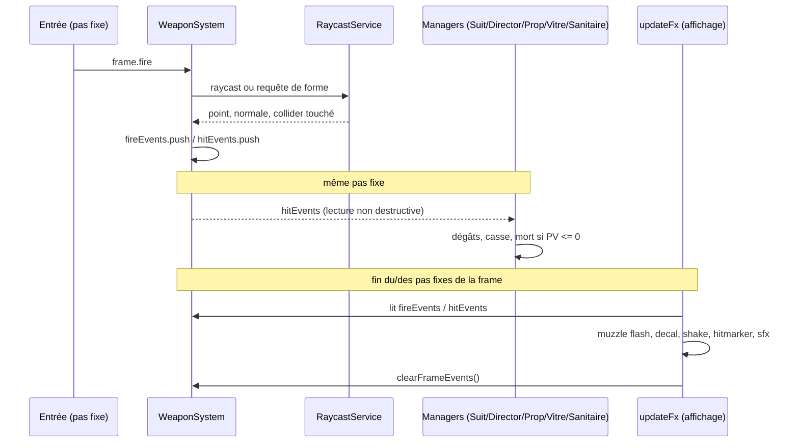

# Armes

## Responsabilité

Fait : sélectionne l'arme active, avance ses cooldowns et ses munitions,
résout ses tirs par raycast ou par requête de forme, déclenche le hitstop et
porte l'état de recul du viewmodel — uniquement des nombres, aucun mesh ni
matériau. Fait voler les fusées du pistolet de détresse, d'un pas fixe à
l'autre, jusqu'à ce qu'elles éclatent. Décide aussi, pour les quatre
ramassages au sol, si le joueur a déjà l'arme (et donc ce que ramasser change).

Ne fait pas : n'applique aucun dégât — `WeaponSystem` produit des `hitEvents`
en lecture seule, c'est `SuitManager`/`DirectorManager`/`PropSystem`/
`VitreSystem`/`SanitaireSystem` qui les lisent au pas fixe suivant et
décident d'une mort, d'une casse ou de rien ([Simulation et présentation](../3-architecture/simulation-et-presentation.md)).
N'applique pas non plus le souffle d'une fusée : `WeaponSystem` dit où elle a
éclaté, `updateBreakables` souffle.
Ne fait pas la géométrie du ramassage au sol : `InteractionSystem` (`game/level/interactions/interactive.ts`)
détecte la proximité, `WeaponSystem` décide seulement de l'effet. Ne dessine
rien : viewmodel, muzzle flash, decals et sons sont posés par `updateFx`/
`render/`, détaillés dans [Sprites et viewmodel](sprites-et-viewmodel.md)
.

## Fichiers

- `src/game/player/weapons/weapons.ts` — `WeaponSystem` : sélection, munitions,
  cooldowns, raycasts/formes, hitstop, recul.
- `src/game/player/weapons/flareFlight.ts` — `FlareFlight` : les fusées du
  pistolet de détresse en vol, leur balayage par rayon et leurs éclatements
  ([ADR 0046](../decisions/0046-projectile-du-joueur.md)).
- `src/game/player/weapons/weaponConfig.ts` — `WeaponConfig` (source unique de
  vérité des nombres), `damageForWeapon`, les quatre tables de variantes
  A/B/C (`RECOIL_VARIANTS`, `IMPACT_VARIANTS`, `HITMARKER_VARIANTS`,
  `CROSSHAIR_VARIANTS`).
- `src/game/level/interactions/interactive.ts` — `InteractionSystem.collectWeapons` : la
  géométrie du ramassage au sol des quatre armes, en marchant dessus (commit
  `6b768f1`, voir Pièges).
- `src/game/loop/updateGameplay.ts` — appelle `collectWeapons` puis
  `weapons.update`, dans cet ordre, après `player.update`.
- `src/game/loop/updateFx.ts` — seul lecteur de `fireEvents`/`hitEvents` côté
  présentation ; seul appelant de `weapons.clearFrameEvents()`.
- `src/game/loop/steps/breakableSteps.ts` — applique le souffle des fusées
  éclatées, sur les props puis sur les vivants.
- `src/render/fx/fx.ts` — `MUZZLE_FLASH_PRESETS`, muzzle flash et douille éjectée.
- `src/render/fx/flares.ts` — la fusée visible en vol : cœur, lueur rouge,
  étincelles.
- `src/render/overlays/hitmarker.ts`, `src/render/overlays/crosshair.ts`,
  `src/render/debug/ballisticsDebug.ts` — canaux de confirmation de hit, réticule,
  gizmos de debug (touche `B`).

## Où ça s'insère dans la boucle

Ordre complet : [Boucle et temps](../3-architecture/boucle-et-temps.md). Dans
le même pas fixe :

1. `InteractionSystem.collectWeapons` (armes au sol), avant `weapons.update` —
   même bloc que `collectHeals`/`collectAmmo`. Un ramassage n'est vu par
   `activeWeapon` qu'au pas suivant : un pas de retard, invisible.
2. `weapons.update(dt, frame, eyeOrigin, yaw, pitch)` (étape `fireWeapons`, `src/game/loop/steps/combatSteps.ts`) —
   `eyeOrigin` est reconstruite depuis `session.player.position`
   **après** `player.update`, jamais depuis une position interpolée (même
   règle que pour l'origine de tir, [Joueur](joueur.md)). `dt` porte
   déjà le hitstop. Les fusées déjà en vol avancent ici, avant le tir du pas :
   une fusée ne parcourt rien le pas où elle part, et celle qui touche pousse
   son `HitEvent` dans la même file que les autres armes.
3. Encore dans ce pas fixe, immédiatement après : `suitManager.update`/
   `directorManager.update`/`propSystem.update`/`vitreSystem.update`/
   `sanitaireSystem.update` lisent tous `weapons.hitEvents`, chacun avec son
   propre curseur — un tir touche donc sa cible le même pas fixe où il part,
   jamais un pas de retard.
4. Toujours dans ce pas, `updateBreakables` prend les fusées éclatées
   (`weapons.takeNewFlareDetonations()`) et applique leur souffle : le mobilier
   d'abord, puis le joueur et les ennemis.
5. Au taux d'affichage, `interpolateVisuals` pose les fusées en vol entre
   leurs deux dernières positions (`fx.poseFlares`).
6. Au taux d'affichage, `updateFx` lit `weapons.fireEvents`/`hitEvents` (muzzle
   flash, douille, sfx, decal, particules, shake, hitmarker, pulsation du
   réticule, gizmos de debug), puis appelle `weapons.clearFrameEvents()` en
   tout dernier — après tous les autres lecteurs de la même frame.

Si `!engine.flow.isPlaying()`, `updateGameplay` retourne avant d'atteindre ce
bloc : aucune arme n'avance, le pas fixe continue de tourner (invariant #1).

Le même tir, du bouton pressé jusqu'à l'écran :

## Données et contrats

**`WeaponKind`** (`"none" | "melee" | "pistol" | "shotgun" | "flare"`, dans
`src/game/player/weapons/weaponTypes.ts`) et `FiringWeapon` (le même sans
`"none"`, plus `"kick"`) : une arme absente ne produit ni tir
ni impact, `update()` ignore alors silencieusement `frame.fire`.

**Munitions, quatre régimes** :

| Arme | Munitions | Ramassage répété |
|---|---|---|
| Pied-de-biche | Aucune | Rien (`tryCollectMelee` renvoie `false` si déjà possédé) |
| Pompe | Rechargeable par les boîtes `cartouches`, plafonné à `shotgunMaxAmmo` | Un second fusil reste au sol ; une boîte recharge via `addShotgunAmmo` |
| Pistolet | Pool rechargeable, plafonné (`pistolMaxAmmo`) | Recharge (`addPistolAmmo`) |
| Pistolet de détresse | Fusées rechargeables par les boîtes `fusees`, plafonnées à `flareMaxAmmo` | Recharge (`addFlareAmmo`), comme le pistolet |

`tryCollectMelee`/`tryCollectShotgun`/`tryCollectPistol`/`tryCollectFlare`
sont appelées par les callbacks de `WeaponPickupHandlers` (`interactive.ts`) :
chacune décide « déjà possédée ? » et retourne si l'objet doit disparaître du
monde. `hasPistolAlready` et `hasFlareAlready` existent uniquement pour que
l'appelant choisisse entre les deux messages HUD (« récupéré » vs
`+N munitions`) avant l'appel.

**Fusées** (`FlareProjectile`, `FlareDetonation`, dans `weaponTypes.ts`) : une
fusée en vol porte sa position, sa position du pas précédent, sa vitesse et son
âge ; l'affichage interpole entre les deux positions. Une fusée éclatée est
publiée deux fois, dans deux files : `flareDetonations`, que l'affichage lit et
que `clearFrameEvents` vide, et celle de `takeNewFlareDetonations()`, remise
une seule fois au pas fixe qui applique le souffle.

**`FireEvent`/`HitEvent`** (fichiers en tête de `weapons.ts`) : deux files
accumulées au pas fixe, lues en lecture seule à l'affichage, contrat détaillé
dans [Simulation et présentation](../3-architecture/simulation-et-presentation.md#comment-linformation-passe-du-pas-fixe-à-laffichage).
`HitEvent.colliderHandle` route le dégât vers l'entité propriétaire sans que
`weapons.ts` connaisse aucun manager d'ennemi. `HitEvent.material` vaut
`"flesh"` (`FLESH_MATERIAL`) ou un placeholder générique (`"concrete"`),
décidé par `materialForCollider` à partir des seuls bits d'appartenance
Rapier (`GROUP.ENEMY`) — jamais du filtre.

**`damageForWeapon(weapon)`** (`weaponConfig.ts`) : table plutôt qu'un
ternaire recopié dans chaque manager — un ternaire à trois armes se trompe en
silence quand une nouvelle arme s'ajoute.

Les dégâts et les autres valeurs configurées sont récapitulés dans la
[référence des armes](../6-reference/valeurs-armes.md). Pour le pompe,
`damageForWeapon` renvoie les dégâts par plomb ; le total dépend du nombre de
plombs qui touchent.

**RNG** : le pompe et le pistolet partagent le même flux
`DeterministicRandom.forSeed(SHOTGUN_SPREAD_SEED)`, construit une fois à la
création de `WeaponSystem` (invariant #12) — jamais `Math.random()`. La
dispersion échantillonne un disque projeté dans le cône de visée (rayon
∝ √u₁, azimut = u₂·2π), une approximation standard d'un cône uniforme.

**Horloges du viewmodel** (`sinceMeleeFire`, `sincePistolFire`,
`sinceShotgunFire`, `sinceFlareFire`, `sinceSwitch`) : avancées au pas fixe pour que le hitstop
les ralentisse aussi, lues uniquement par le rendu. Aucune ne conditionne un
tir ou un changement d'arme (invariant #10) — un nouveau tir peut partir
avant même que l'arme ait fini de remonter à l'écran.

**Quatre familles de variantes A/B/C** dans `weaponConfig.ts`
(`RECOIL_VARIANTS`, `IMPACT_VARIANTS`, `HITMARKER_VARIANTS`,
`CROSSHAIR_VARIANTS`), chacune isolée sur un seul aspect du feedback (recul,
hitstop/shake mur-vs-ennemi, marqueur de hit, style de réticule) sans jamais
toucher dégâts/cadence/munitions. Protocole de comparaison au pas fixe près
(F9/F10) : [Régler la sensation](../5-guides/regler-la-sensation.md).

## Pièges

**Portée du pied-de-biche : une requête de forme, pas un point.** Le coup
teste une capsule couvrant tout le segment `eyeOrigin` →
`eyeOrigin + direction * meleeRange`, pas une sphère unique à son extrémité.
Une sphère centrée sur le bout de la portée laisse une bande morte devant les
yeux : une cible collée au joueur tombe hors de cette bande et le coup ne
peut géométriquement pas toucher à bout portant, quelle que soit sa taille —
constaté en playtest (« je n'ai pas l'impression de toucher à bout portant »),
pas un choix de feel.

**Le carré blanc était le muzzle flash de la mêlée, pas un bug de rendu.**
Un retour de playtest (« cette espèce de carré blanc… ça fait mal aux yeux »)
a mené à un flash déclenché pour CHAQUE arme sans distinction, avec l'œil du
joueur comme origine pour la mêlée : un quad blanc à 15 cm de la caméra
couvre l'essentiel du champ à 640×360. Corrigé en retirant tout muzzle flash
pour la mêlée — le pied-de-biche n'a pas de canon — et le typage l'empêche
de revenir en silence : `MUZZLE_FLASH_PRESETS` (`render/fx/fx.ts`) est un
`Record<"pistol" | "shotgun", …>`, `"melee"` n'y a pas d'entrée possible.

**L'origine de tir ne vient jamais d'une position interpolée.**
`eyeOrigin` est reconstruite depuis `session.player.position` après
`player.update`, jamais depuis `player.eyePosition()` (le rendu) : sinon le
rejeu d'input (F9/F10) diverge selon le framerate d'affichage à
l'enregistrement — même piège que documenté dans [Joueur](joueur.md#pièges)
et [Boucle et temps](../3-architecture/boucle-et-temps.md#pièges).

**Une arme au sol ne doit jamais concurrencer la touche `E`.**
`InteractionSystem.update` (recherche du `use_*` le plus proche pour l'appui
`E`) exclut explicitement les trois noms d'armes (`isWeaponPickupName`) :
sans cette garde, une arme posée à portée volerait l'appui `E` à un
sanitaire ou une porte plus proche. `collectWeapons` les ramasse séparément,
en marchant dessus, comme une trousse ou une boîte de munitions.

**Le hitstop ne se cumule jamais entre plusieurs plombs d'un même tir.**
`triggerHitstopFor` (appelé jusqu'à `shotgunPelletCount` fois pour un seul
tir de pompe) écrase la durée/l'échelle en cours plutôt que de les additionner
(`GameClock.triggerHitstop`, dernier appel gagnant) — un tir à 9 plombs sur un
Costard ne « sur-arme » donc pas 9× plus fort qu'un plomb seul.

**La fusée part des yeux, l'image la fait partir du canon.** Même règle que
ci-dessus : la trajectoire simulée commence à `eyeOrigin`. `Flares.pose`
(`render/fx/flares.ts`) décale le dessin vers le bout du canon affiché et
résorbe cet écart en 0,14 s de vol. Ne jamais « corriger » en lançant la fusée
depuis le viewmodel : sa position dépend du rendu.

**Le souffle d'une fusée ne se lit pas dans la file d'affichage.**
`flareDetonations` est vidée à chaque image par `clearFrameEvents`. Lue par le
pas fixe, elle ferait souffler deux fois une fusée quand deux pas tombent dans
la même image, et jamais quand une image passe sans pas. Le pas fixe lit
`takeNewFlareDetonations()` — le même partage que `PropSystem.explosionEvents`
et `takeNewExplosions()`.

**La vitesse d'une fusée est fixée au tir.** Modifier `weaponConfig.flareSpeed`
à chaud ne change que les fusées suivantes ; `flareGravity` et `flareLifetime`,
elles, sont relues à chaque pas.

## Tests

- `test/game/player/weapons/weaponClocks.test.ts` — horloges du viewmodel, aucune ne
  bloque un tir ou un changement (invariant #10).
- `test/game/player/weapons/weaponPickups.test.ts` — `tryCollectMelee`/
  `tryCollectShotgun`/`tryCollectPistol` : la décision « déjà possédée »,
  symétrie et exception du pistolet.
- `test/game/player/weapons/pistol.test.ts` — possession, dotation, cadence, plafond
  de munitions (mécanique du tir, pas la balistique — monde physique vide).
- `test/game/player/weapons/flare.test.ts` — le pistolet de détresse : possession,
  cadence, vol et chute de la fusée, impact sur un vrai mur Rapier, éclatement en
  l'air, même résultat à chaque déroulé, file du souffle distincte de l'affichage.
- `test/game/session/player/explosions.test.ts`, `test/game/level/props/props.test.ts` —
  le souffle d'une fusée sur les vivants et sur le mobilier.
- `test/game/level/interactions/pickups.test.ts` — traversée complète loader → `UseObject`
  → `InteractionSystem.collectHeals`/`collectAmmo`/`collectWeapons`.
- `test/game/integration/gameplayStep.test.ts`, `gameSessionReset.test.ts` —
  la place de `WeaponSystem` dans un pas fixe réel et sa survie à un reset.
- `test/render/viewmodel/viewmodel.test.ts` — tirer pendant le changement d'arme remet
  l'arme en place aussitôt (invariant #10).

Aucun test dédié ne couvre `fireMelee`/`firePistol`/`fireShotgun` contre un
monde physique peuplé (géométrie d'impact, matériau perçu) : pour ces trois
armes, la couverture porte sur la mécanique (munitions, cooldowns, ramassage),
pas sur la balistique elle-même. La fusée, elle, est testée contre un mur.

## Comment vérifier que ça marche

- `pnpm test -- weaponClocks weaponPickups pistol flare pickups gameplayStep`.
- En salle d'essai (`?level=gym`), le pistolet de détresse n'est pas au sol :
  `cassandre.weapons.pickUpFlare()` le donne, la touche `4` y revient.
- Console `cassandre.weapons` : l'instance `WeaponSystem` réelle
  (`activeWeapon`, `shotgunAmmo`, `pistolAmmo`, `fireEvents`, `hitEvents`).
- `cassandre.weaponConfig` : mutation à chaud de tout `WeaponConfig`.
- `cassandre.applyRecoilVariant`/`applyImpactVariant`/`applyHitmarkerVariant`/
  `applyCrosshairVariant("A"|"B"|"C"` ou nom de variante`)` : bascule chaque
  harnais indépendamment.
- Touche `B` (`src/render/debug/ballisticsDebug.ts`) : gizmos des rayons/capsule
  réellement testés par le dernier tir — confirme la portée du pied-de-biche
  et le cône du pompe visuellement.

## Décisions

- [ADR 0029 — Armes en vue subjective](../decisions/0029-armes-en-vue-subjective.md)
- [ADR 0046 — Projectile du joueur](../decisions/0046-projectile-du-joueur.md)
- [ADR 0041 — Explosifs](../decisions/0041-explosifs.md)
- [ADR 0007 — RNG déterministe](../decisions/0007-rng-deterministe.md)
- [ADR 0010 — Curseur explicite d'événements multi-pas-fixe](../decisions/0010-curseur-evenements-multi-pas-fixe.md)
