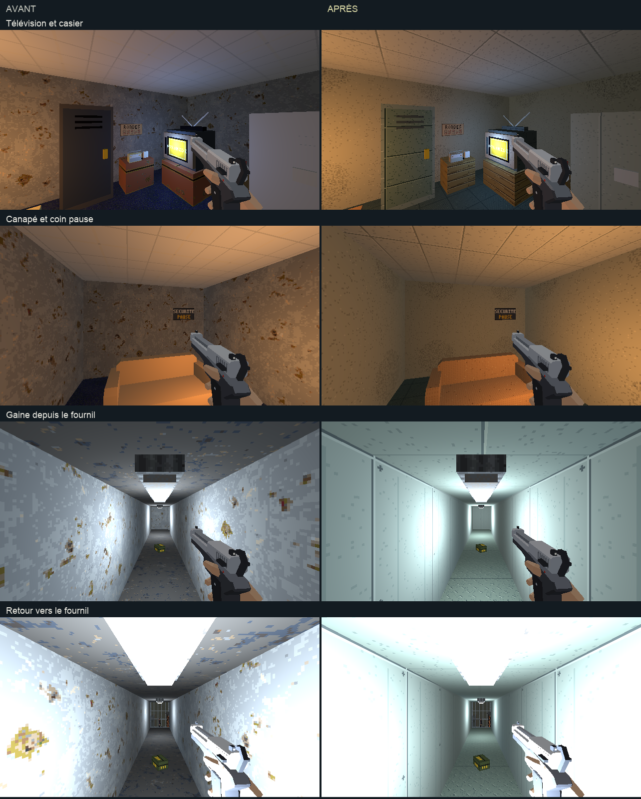

# Direction artistique — planque et gaine VMC

## Objectif

Après validation des [locaux de service](service-direction-artistique.md),
reprendre les deux petits espaces voisins selon la
[charte commune](../5-guides/direction-artistique.md).
[Ouvrir les quatre vues en jeu](annexes-da.html).

## Matières

| Surface | Traitement |
|---|---|
| Murs de la planque | Enduit chaud légèrement marqué, sans les grandes plaques de rouille de l’ancien matériau. |
| Sol de la planque | Moquette verte des bureaux, distincte du tissu du canapé. |
| Plafond de la planque | Panneaux acoustiques rectangulaires ivoire des vestiaires. |
| Canapé | Tissage beige et pieds en bois. |
| Table et caisses | Bois des bureaux et palettes de la réserve. |
| Téléviseur et radio | Plastique taupe, coque sombre et métal, détails de façade conservés. |
| Frigo et casier | Émail, acier mat et peinture verte. |
| Parois de la gaine | Tôle claire avec plis, raccords de panneaux et rivets. |
| Sol de la gaine | Relief antidérapant peint. |
| Plafond de la gaine | Tôle à joints horizontaux, distincte du plancher. |

Les textures de 128×128 couvrent 2 m, à 64 texels/m. La sélection porte
sur 27 meshes : 2 sols, 9 murs, 2 plafonds et 14 éléments de mobilier.
Les matières communes proviennent des passes de la réserve, des bureaux et
des ateliers ; six recettes locales complètent ces familles.

Le téléviseur continue de diffuser sa chaîne animée. Les affiches, boissons,
antivols, pizza, grilles cassables et tube de lampe conservent leurs matériaux.
Les faces jaunes de la poignée et les touches de la radio conservent leurs
couleurs et leurs UV de palette. Aucun volume de collision, éclairage ou
objet interactif n’est déplacé.

## Intégration

`tools/art_direction/store_annexes.py` sélectionne les objets par nom.
La recette rejoint le build normal après la passe des locaux de service.

```sh
blender -b assets_src/blender/niveau_v2.blend \
  -P tools/blender/cassandre_cli.py -- art_direction_annexes inspect=true
blender -b assets_src/blender/niveau_v2.blend \
  -P tools/blender/cassandre_cli.py -- art_direction_annexes
```

L’[inventaire](annexes-da/inventaire.json) contient aussi les voisins proches ;
le [manifeste](annexes-da/deploiement.json) décrit les surfaces réellement
retouchées. La copie avant retouche est conservée dans
`renders/_cassandre/niveau_v2_avant_annexes_da.blend`.

## Revue



Les [quatre poses](annexes-da/poses.json), leurs relevés
[avant](annexes-da/poses-avant.json) et [après](annexes-da/poses-apres.json)
accompagnent les captures du jeu en 640×360 et la
[planche Blender](annexes-da/blender.png).
Le premier essai donne un quadrillage trop grossier au canapé. Le second
affine le tissage à deux texels et réduit le grain des panneaux métalliques.
Les captures de cet essai restent dans `*-essai.png`.

Les quatre vues finales, le rendu Blender et une
[capture après déplacement](annexes-da/en-marche.png) sont ouverts et relus.
La source et l’export sont sauvegardés ; l’export contient 4 001 objets du
view layer sans fuite de bibliothèque.

Les images gardent le même éclairage et les mêmes points de vue ; les écrans
animés peuvent montrer des images différentes.

Aucune suite de tests automatisés n’est lancée. La proposition attend
le retour artistique de l’utilisateur.
