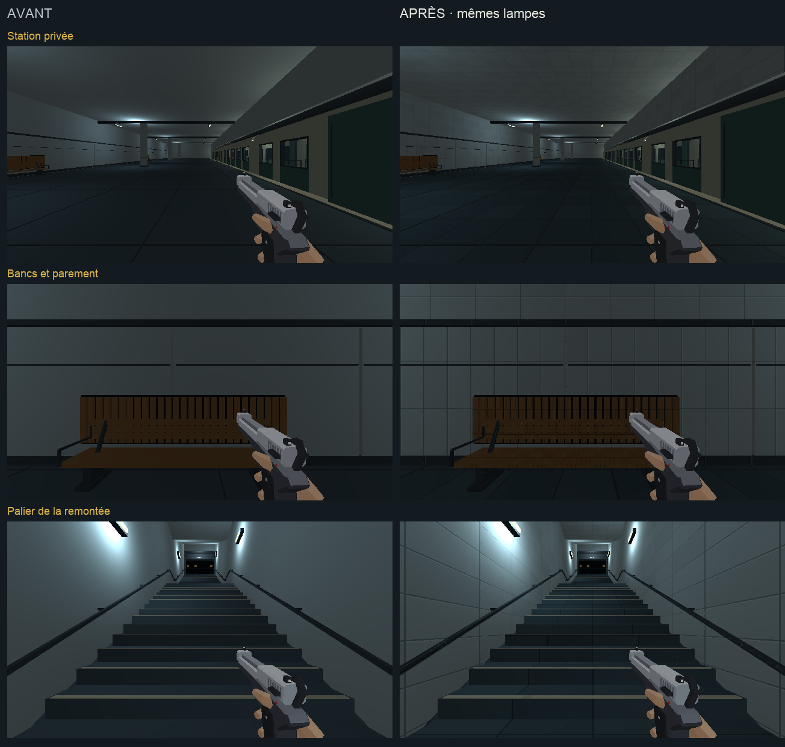

# Direction artistique — station privée et parvis

## Objectif

Prolonger [l'étalon approuvé](etalon-direction-artistique.md) dans la station
privée, les quatre volées de la remontée et le parvis de la tour. Cette passe
poursuit l'étape 2 de [l'audit](../journal/audit-direction-artistique-2026-10.md),
après [la machinerie et le poste](technique-direction-artistique.md).

[Ouvrir la revue en jeu](arrivee-da.html).



[Comparer le parvis, les jardins et l'entrée](arrivee-da/parvis.png).

## Traitement

- Parements : pierre gris-bleu, joints fins et variations entre panneaux.
- Sols : grandes dalles froides sur le quai, dans la remontée et sur le
  parvis ; pavés distincts sur l'axe central et au départ de l'escalier.
- Bancs : bois de la charte, structures et mains courantes en acier.
- Jardin : pierre des jardinières et texture de feuillage propre, avec
  nervures et petites variations vertes. La végétation conserve sa silhouette.
- Tour : socle, marquise, cadres et commande prolongent les matières de la
  gare ; la copie de tour propre à l'arrivée reçoit les peintures communes.
- Repères : nez de marche, bande de quai et poignées en peinture ivoire.

Les textures répétées utilisent 128×128 pour 2 m, soit 64 texels/m.
Les quatre nouvelles rampes conservent la dominante froide des lieux.
Les positions, dimensions, proxies et lampes restent ceux du niveau existant.
Les vitrages, lampes et faces noires conservent leur traitement.
Le ciel étoilé et son horizon orange restent ceux du jeu ; leur raccord
aux illustrations appartient au lot histoire et effets de l'audit (DA-05).

## Reproduire

`tools/art_direction/metro_arrival.py` sélectionne les surfaces des groupes
`privee`, `remontee` et `parvis`, leurs kits de détail, le socle et la copie
de tour attachée à `stage_voyage_arrivee`. `metro_materials.py` construit les
matières communes et les quatre recettes de `surface_recipes.py`.

`tools/metro/blockout/tower_plaza_furniture.py` sépare la matière de la
végétation avant consolidation, pour lui donner un motif de feuillage.
La recette fait partie de la reconstruction normale du métro.

```sh
/Applications/Blender.app/Contents/MacOS/Blender -b --factory-startup \
  -P tools/blender/cassandre_cli.py -- metro_blockout apercus=false
```

Sorties : `assets_src/blender/metro_blockout.blend`,
`public/assets/levels/metro_blockout.glb` et
[manifeste de déploiement](arrivee-da/deploiement.json).
46 meshes reçoivent les matières de cette passe. L’export contrôlé conserve
4 350 objets, sans intrus de bibliothèque.

## Observation

La revue utilise le vrai niveau `metro`, en 640×360/aniso, avec l'équipement
type et un pistolet. Ses [six poses](arrivee-da/poses.json) couvrent le quai,
un banc, le palier de la remontée, le parvis, les jardins et l'entrée.

La page actionne avec E les commandes d'aiguillage, de courant et de départ
aux poses correspondantes. Elle raccourcit uniquement le voyage de cette
revue à 10 s, puis rétablit sa configuration. L'arrivée se fait par le
mécanisme normal du niveau ; les décors de départ et d'arrivée conservent
leur visibilité prévue. Les ennemis sont neutralisés et les trains suspendus
pour comparer les surfaces. Aucun changement du voyage de campagne n'est
appliqué.

Les six captures de chaque version utilisent les mêmes poses demandées,
les mêmes lampes et le même équipement. Elles montrent le monde sans les
overlays du HUD. Les [poses observées avant](arrivee-da/poses-avant.json) et
[après](arrivee-da/poses-apres.json) sont conservées.
Les [six vues Blender](arrivee-da/blender.png), rendues en Workbench texturé
avec `sheet(..., voyage="arrivee")`, et les deux planches de comparaison
sont ouvertes et relues. Le rendu du jeu arbitre la lecture finale.

Un déplacement de 0,5 s depuis le palier va de y=448,5, z=−8,49 à
y=451,9, z=−7,02. La [vue en montée](arrivee-da/remontee-en-marche.png) et
[son relevé](arrivee-da/deplacement.json) sont conservés.
Aucune suite de tests automatisés n'est lancée. Cette observation ne
remplace pas un playtest des combats ni une mesure de performance complète.

## Suite

La [rame de service et les voitures de trafic](rame-direction-artistique.md)
reçoivent la passe suivante, avant le lot du magasin et des objets proches. Les interactions et la
signalétique gardent leur lot dédié.
