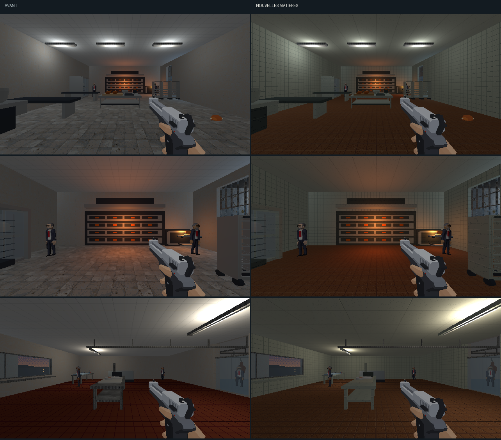

# Direction artistique — fournil, labo et SAV

## Objectif

Prolonger la [passe du personnel et des bureaux](bureaux-direction-artistique.md)
dans les ateliers du magasin. Les matières suivent la
[charte commune](../5-guides/direction-artistique.md), avec des sols et
plafonds distincts. [Ouvrir la revue](ateliers-da.html).



[Comparer les surfaces proches et le SAV](ateliers-da/details.png).

## Matières

| Surface | Traitement |
|---|---|
| Four et labo | Grès rouge-brun de 25 cm, grain et joints discrets. |
| Murs du fournil et du labo | Faïence ivoire à joints de 25 cm, distincte de l’enduit du SAV. |
| Plafonds | Panneaux lessivables mats de 1 × 2 m, grands raccords et grain discret. |
| Cuves, tables, robinets et four | Inox brossé clair ; les corps sombres gardent une rampe propre. |
| Planche de découpe | Polyéthylène ivoire avec traits de couteau. |
| Guichet et établis du SAV | Caissons mats, dessus en bois veiné et plan clair du guichet. |
| Appareils de retour | Émail mat sur les caissons ; façades et tickets conservés. |
| Sol du SAV et carton de retour | Recettes de la réserve. |

La recette traite 59 meshes : 4 surfaces de sol (le labo a une dalle de
base et un parement), 26 éléments de paroi, 3 plafonds et 26 éléments de
mobilier. Douze familles de textures de 128×128 couvrent 2 m, à 64 texels/m.
Les joints déjà modélisés du labo conservent leur géométrie et reçoivent une
couleur moins contrastée. Les matériaux du guichet et des établis sont
répartis par hauteur sur leur mesh existant.

Les façades de téléviseurs, instruments, tickets, produits, boutons,
vitrages et lampes gardent leurs détails. La pâte, les pains, la viande,
les poissons et la farine gardent leurs matériaux. L’éclairage restauré,
les colliders et les propriétés d’interaction sont conservés. Aucun module
runtime n’est modifié.

## Fours reconstruits

Après cette passe de matières, les appareils de cuisson sont repris dans une
[retouche dédiée](fours-fournil.md) : deux modules à soles, chambres ajourées,
vitres et rôtissoire. Les images ci-dessus gardent l’état de la passe de
textures ; la [revue des fours](fours-fournil.html) montre le modèle actuel.

## Reprise

`tools/art_direction/store_workshops.py` sélectionne les surfaces et le
mobilier par nom. `tools/art_direction/surface_recipes.py` produit les motifs.
Le build normal rejoue cette passe après celle des bureaux.

```sh
blender -b assets_src/blender/niveau_v2.blend \
  -P tools/blender/cassandre_cli.py -- art_direction_workshops inspect=true
blender -b assets_src/blender/niveau_v2.blend \
  -P tools/blender/cassandre_cli.py -- art_direction_workshops
```

L’[inventaire](ateliers-da/inventaire.json) inclut les voisins proches ; le
[manifeste](ateliers-da/deploiement.json) décrit la sélection effective.
La source sauvegardée exporte 3 988 objets sans intrus de bibliothèque.
La copie avant passe reste dans `renders/_cassandre/niveau_v2_avant_ateliers_da.blend`.

## Revue

Les [six poses](ateliers-da/poses.json) montrent l’entrée et le four à sole,
le labo et sa table de découpe, puis le SAV et un établi proche. Les
comparaisons gardent les mêmes poses, lampes et résolution interne 640×360.
Les écrans et interactions animées continuent leur cycle pendant les captures.
La [planche Blender](ateliers-da/blender.png) complète les vues du jeu.

Le premier rendu fait trop ressortir les joints du sol du labo. La seconde
version rapproche leur valeur de celle du grès, sans changer leur géométrie.
Les vues du jeu et de Blender sont ouvertes et relues. Une
[vue après déplacement](ateliers-da/en-marche.png) montre aussi le fournil.

Aucune suite de tests automatisés n’est lancée. La proposition attend
l’arbitrage artistique de l’utilisateur.
