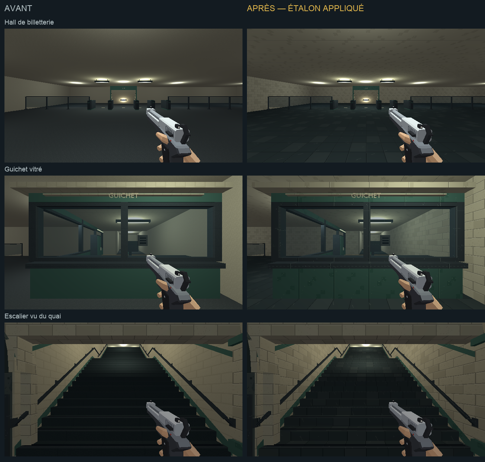

# Direction artistique — billetterie et descente

## Objectif

Prolonger le traitement des [quais et tunnels](quais-direction-artistique.md)
dans la billetterie publique et la descente vers les quais. Cette passe
appartient à l'étape 2 de [l'audit](../journal/audit-direction-artistique-2026-10.md)
et reprend [l'étalon approuvé](etalon-direction-artistique.md).

[Ouvrir la revue en jeu](billetterie-da.html).



[Comparer les bornes, les portiques et le départ de la descente](billetterie-da/details.png).

## Traitement

- Murs : carrelage ivoire nuancé, dans la continuité des quais.
- Sols : mêmes dalles sombres dans le hall, l'arrière-guichet et l'escalier.
- Plafonds du hall : peinture ivoire mate, distincte du carrelage mural.
- Guichet, bornes et portiques : acier, peinture pétrole et bois ; les
  vitrages et lampes conservent leur traitement.
- Descente : murs et plafond carrelés, rampes et nez de marche en acier ;
  marquages au sol et lettres en peinture ivoire.

Les motifs répétés gardent 128×128 pour 2 m. Les petits écrans, pictogrammes,
papiers et fonds des plans du réseau utilisent une finition calme.
Les positions et dimensions des portes, vitres, passages, marches et
proxies restent celles du niveau existant. Les lampes gardent leurs couleurs,
intensités et portées.

## Reproduire

`tools/art_direction/metro_ticket_hall.py` sélectionne les surfaces de
billetterie réellement découpées et les kits du guichet, des portiques,
du mobilier et de la descente. Il réemploie les matières construites par
`metro_materials.py`, communes avec les passes précédentes.

`tools/metro/blockout/geometry.py` sépare le matériau des plafonds de
billetterie avant la consolidation. `station_descent.py` sépare les
marquages et le texte du carrelage. Ces modifications concernent les
matériaux des surfaces existantes.

```sh
/Applications/Blender.app/Contents/MacOS/Blender -b --factory-startup \
  -P tools/blender/cassandre_cli.py -- metro_blockout apercus=false
```

Sorties : `assets_src/blender/metro_blockout.blend`,
`public/assets/levels/metro_blockout.glb` et
[manifeste de déploiement](billetterie-da/deploiement.json).
43 meshes reçoivent les matières de cette passe. L'export contrôlé contient
4 350 objets, sans intrus de bibliothèque. Les cinq meshes supplémentaires
par rapport à la passe précédente séparent les matériaux des quatre
plafonds et des marquages de l'escalier ; ils n'ajoutent pas de géométrie.

## Observation

La revue utilise le vrai niveau `metro`, en 640×360/aniso, avec l'équipement
type et un pistolet. Ses [six poses](billetterie-da/poses.json) couvrent le
hall, le guichet, les bornes, les portiques, le départ de la descente et
l'escalier vu du quai. Les ennemis sont neutralisés pour observer les lieux.
Les captures du monde ne comprennent pas les overlays du HUD.

Les [six rendus Blender](billetterie-da/blender.png) sont ouverts et relus
en Workbench texturé. Les captures en jeu de chaque version utilisent les
mêmes poses demandées, les mêmes lampes et le même équipement.
Deux déplacements de 0,5 s depuis le quai montrent la montée : de y=120,
z=−12,99 à y=115,34, z=−10,74. La
[capture en montée](billetterie-da/escalier-en-marche.png) et
[son relevé](billetterie-da/deplacement.json) sont conservés.
Aucune suite de tests automatisés n'est lancée.

Le pistolet et la main saturent sous le luminaire proche de la volée basse,
visible sur la capture en montée. Ce point rejoint le lot de valeurs des
armes et personnages ; l'éclairage de la zone est conservé dans cette passe.

Cette passe visuelle ne remplace pas un playtest des combats et ne clôture
pas l'harmonisation de toutes les zones du métro.

## Suite

[Le dépôt et ses ateliers](depot-direction-artistique.md) constituent la passe
suivante. La machinerie et le poste d’aiguillage viennent ensuite.
La station privée garde une sous-palette froide propre ; elle aura sa passe
après les espaces techniques.
