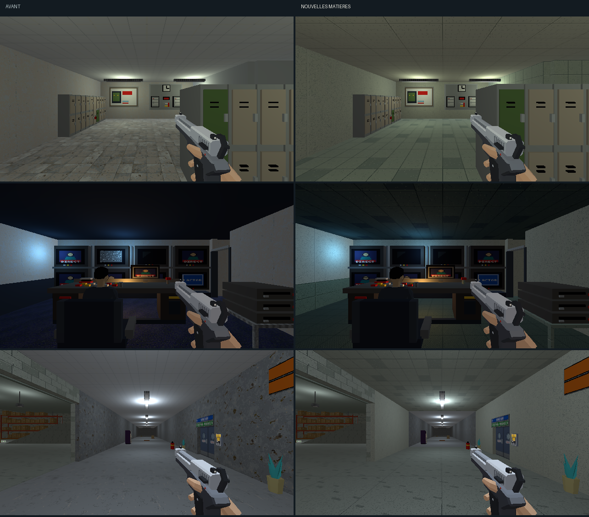

# Direction artistique — personnel et bureaux

## Objectif

Prolonger la [réserve approuvée](reserve-direction-artistique.md) dans le
couloir du personnel, les vestiaires, le PC sécurité et l’étage des bureaux.
La passe suit la [charte commune](../5-guides/direction-artistique.md).
[Ouvrir la revue](bureaux-da.html).



[Comparer l’étage et l’escalier](bureaux-da/details.png).

## Matières

| Surface | Traitement |
|---|---|
| Couloir et marches | Béton jointé et traces de manutention, dans la continuité de la réserve. |
| Vestiaires et cloisons des douches | Carrelage gris-vert, joints et nuances par dalle. |
| PC sécurité, étage et direction | Dalles de moquette gris-vert, trame orientée et contrastes rapprochés. |
| Murs et cloisons | Enduit ivoire, grain irrégulier et raccords verticaux. |
| Plafonds | Dalles mates à joints ; au vestiaire, panneaux acoustiques ivoire de 1 × 0,5 m sur rails fins, distincts du carrelage. Le poste de sécurité garde sa variante sombre. |
| Bureaux, bancs et chambranles | Bois brun veiné. |
| Caissons, supports et cadres | Métal mat brossé. |
| Tiroirs d’archives et soubassements | Peinture vert sourd avec joints. |
| Dossiers | Papier beige, tranches et marques. |
| Palettes et cartons | Recettes de la réserve : bois de manutention, ruban et étiquettes. |

La sélection traite 201 meshes : 6 sols, 84 éléments de paroi, 7 plafonds
et 104 éléments de mobilier. Treize familles de textures de 128×128 couvrent
2 m, à 64 texels/m. Les façades de casiers, poignées, pointage, consoles,
écrans, portes, distributeurs et pictogrammes gardent leurs atlas. Le
mobilier Kenney en palette garde ses couleurs et ses détails assemblés.

Le réglage des lampes reste celui restauré du magasin. Les extras,
interactions, colliders et poses sont conservés. Cette passe ne modifie
aucun module runtime.

## Reprise

`tools/art_direction/store_offices.py` sélectionne par nom et famille de
matériau. Les recettes sont dans `tools/art_direction/surface_recipes.py`.
Le build normal appelle cette passe après celle de la réserve.

```sh
blender -b assets_src/blender/niveau_v2.blend \
  -P tools/blender/cassandre_cli.py -- art_direction_offices inspect=true
blender -b assets_src/blender/niveau_v2.blend \
  -P tools/blender/cassandre_cli.py -- art_direction_offices
```

L’inventaire inclut les objets voisins : la sélection effective est dans
le [manifeste](bureaux-da/deploiement.json). La retouche sauvegarde la source
et exporte les 3 988 objets du niveau sans intrus de bibliothèque. La copie
avant passe reste dans `renders/_cassandre/niveau_v2_avant_bureaux_da.blend`.

## Revue

Les [six poses](bureaux-da/poses.json) montrent les vestiaires, le poste des
caméras, le couloir, la comptabilité, la direction et l’arrivée de l’escalier.
Les captures [avant](bureaux-da/poses-avant.json) et
[après](bureaux-da/poses-apres.json) utilisent les mêmes poses et lampes,
au rendu interne 640×360. Les écrans animés changent de contenu au fil du temps ; les portes peuvent
changer d’état au passage des déclencheurs de niveau.
La [planche Blender](bureaux-da/blender.png) complète les vues du jeu.

Le premier essai fait trop ressortir la trame de moquette et des motifs
répétitifs dans l’enduit. Le second rapproche les tons du textile, affine
sa trame et remplace le grain corrélé des murs par un grain déterministe
irrégulier. Les images Blender et les vues du jeu sont ouvertes et relues.
Le retour utilisateur signale ensuite la ressemblance du sol et du plafond
des vestiaires. Une recette dédiée donne au plafond des panneaux acoustiques
rectangulaires ivoire avec de petites perforations, alors que le sol conserve
son carrelage gris-vert carré.
La [vue après déplacement](bureaux-da/en-marche.png) montre aussi le couloir.

Aucune suite de tests automatisés n’est lancée. La proposition attend
l’arbitrage artistique de l’utilisateur.

## Retouche des sols et plafonds — 11 octobre

L’utilisateur demande une moquette comme avant et un faux plafond dans
les bureaux et la direction. La [retouche dédiée](bureaux-finitions.md)
remplace les dalles gris-vert de l’étage par un textile bleu continu et
pose des profils en relief sous des panneaux acoustiques clairs.
Les comparaisons ci-dessus décrivent la première passe ; la page dédiée
montre le nouvel état.
