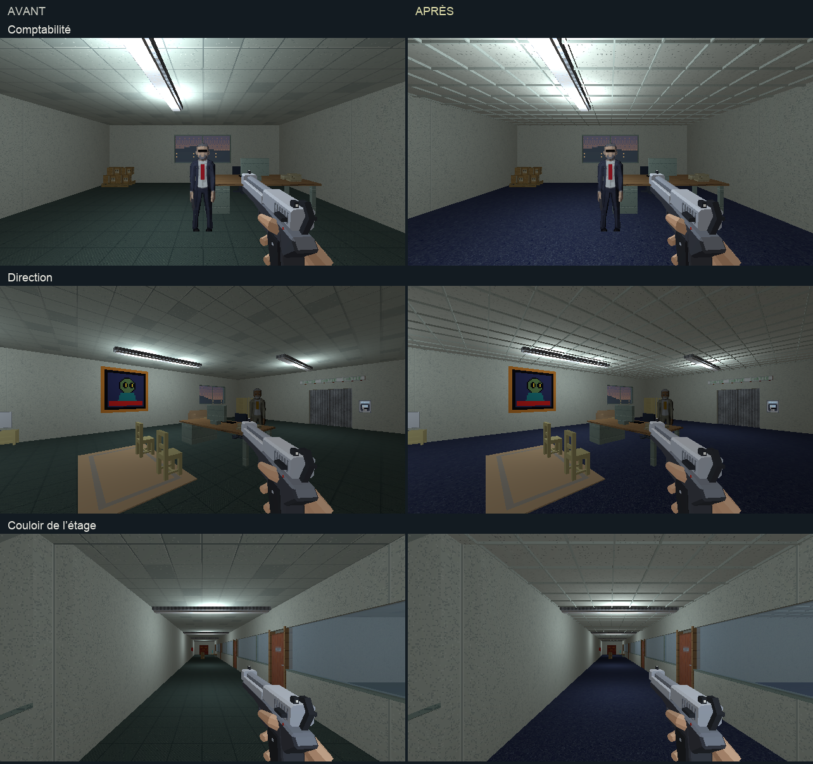

# Bureaux — moquette et faux plafond

## Retour utilisateur

L’utilisateur demande de reprendre les sols et plafonds des bureaux et de la
direction : retrouver une moquette comme avant et poser un faux plafond.
Cette retouche complète la [passe des bureaux](bureaux-direction-artistique.md).
[Ouvrir les trois vues en jeu](bureaux-finitions.html).

## Proposition

- Moquette bleue continue dans les bureaux, le couloir de l’étage et la
  direction. Le bleu de l’ancienne texture `sol_moquette.png` sert de
  référence ; la nouvelle recette conserve un grain textile sans joints
  de carrelage ni inversion de trame par dalle.
- Plafond acoustique ivoire clair, à pores discrets, sur une ossature
  visible en relief. Les modules mesurent 60 cm et les profils 25 mm.
  Les profils descendent de 4 cm sous le plafond existant.
- Les barres transversales s’arrêtent aux longerons : aucune face de grille
  ne se superpose à une autre. Deux meshes regroupent les profils, un par
  espace. Les luminaires gardent leurs positions et leur éclairage.

Les deux sols et les deux parements de plafond sont repris. Les colliders,
portes et objets interactifs conservent leurs valeurs. Les autres locaux
ne reçoivent pas cette variante de moquette ou de plafond.

Les trois textures couvrent 2 m avec 128×128 pixels, à 64 texels/m.
Les matériaux partagés du PC sécurité et de la planque conservent leur
recette précédente.

## Intégration

`tools/art_direction/store_office_finishes.py` sélectionne les quatre
surfaces et reconstruit les deux ossatures. `store_offices.py` utilise ces
mêmes recettes et cette géométrie dans le build normal.

```sh
blender -b assets_src/blender/niveau_v2.blend \
  -P tools/blender/cassandre_cli.py -- rework_office_finishes
```

Le [manifeste](bureaux-finitions/deploiement.json) décrit les surfaces et
les ossatures. La source et l’export sont sauvegardés ; l’export contient
4 003 objets du view layer, sans intrus de bibliothèque. La copie avant
retouche reste dans `renders/_cassandre/niveau_v2_avant_bureaux_finitions.blend`.

## Revue



Les [trois poses](bureaux-finitions/poses.json) et leurs relevés
[avant](bureaux-finitions/poses-avant.json) / [après](bureaux-finitions/poses-apres.json)
accompagnent les captures internes 640×360 et la
[planche Blender](bureaux-finitions/blender.png) et la
[vue de géométrie](bureaux-finitions/blender-geometrie.png). Les vues Blender
et les trois captures du jeu sont ouvertes et relues. Les animations des écrans
et l’état des portes peuvent changer entre deux captures.

La [vue après déplacement](bureaux-finitions/en-marche.png) complète la
revue du couloir. La proposition attend le retour artistique de l’utilisateur.
Aucune suite de tests automatisés n’est lancée.
