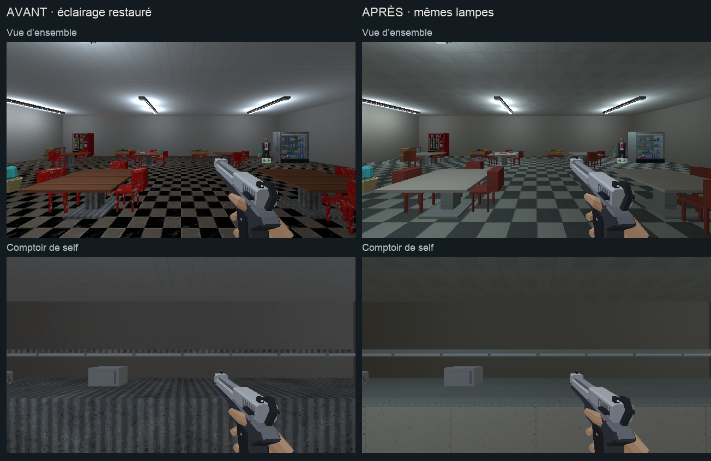

# Direction artistique — cafétéria du magasin

## Objectif

Poursuivre l’étape 3 [de l’audit](../journal/audit-direction-artistique-2026-10.md)
après [la surface de vente](vente-direction-artistique.md), dans une seule pièce.
L’éclairage d’origine reste en place, conformément au retour utilisateur.

[Ouvrir la revue en jeu](cafeteria-da.html).



[Comparer les tables et le retour vers le self](cafeteria-da/details.png).

## Traitement

- Sol : damier gris-ivoire commun aux rayons, avec des carreaux de 50 cm.
- Tables et corps du self : stratifié ivoire des comptoirs de caisse.
- Chaises et poubelles : peinture rouge atténuée, avec un grain discret.
- Pieds, socles, glissière, vitrine et bacs du self : métal clair mat.
- Parois : enduit ivoire à grain léger ; les grandes taches contrastées disparaissent.
- Plafond : dalles claires à joints fins, dont les tons restent proches.
- Fontaine, frigo, présentoirs, plateau-repas et quelques props : émail,
  métal et carton dans les familles communes du magasin.

La sélection comprend 1 sol, 11 éléments de paroi, 1 plafond et
52 éléments de mobilier, soit 65 meshes. Les neuf textures utilisent
128×128 pixels pour 2 m, avec des UV métriques.
Les produits, les appareils en atlas, les distributeurs et les lampes
conservent leurs matières. Les positions, les colliders et les interactions
restent ceux de la pièce construite.

## Reproduire

`tools/art_direction/store_cafeteria.py` sélectionne les éléments par leur
nom et leur famille, sans remplacer les matériaux partagés du reste du niveau.
Les recettes répétées vivent dans `tools/art_direction/surface_recipes.py`.
`tools/blender/refresh_store_cafeteria.py` sauvegarde la source et exporte
le niveau contrôlé. La copie avant cette passe est conservée dans
`renders/_cassandre/niveau_v2_avant_cafeteria_da.blend`.

```sh
/Applications/Blender.app/Contents/MacOS/Blender \
  -b assets_src/blender/niveau_v2.blend \
  -P tools/blender/cassandre_cli.py -- art_direction_cafeteria
```

La reconstruction normale `tools/level_v2/build_niveau.py` appelle cette
recette après les matières des caisses et de la surface de vente.
Le build complet n’est pas relancé pendant cette retouche locale.

Sorties : `assets_src/blender/niveau_v2.blend`,
`public/assets/levels/niveau_v2.glb` et
[manifeste des matières](cafeteria-da/deploiement.json).
L’export contrôlé contient 3 977 objets, sans intrus de bibliothèque.

## Observation et révision

Les [quatre poses](cafeteria-da/poses.json) montrent la pièce, le comptoir,
les tables et le retour vers le self. Les captures en 640×360/aniso utilisent
les mêmes lampes, le même pistolet et l’équipement type. Les relevés
[avant](cafeteria-da/poses-avant.json) et [après](cafeteria-da/poses-apres.json)
accompagnent les images du monde sans les overlays.

Le [premier essai](cafeteria-da/essai-plafond-trop-contraste.png) fait trop
ressortir les variations entre les dalles du plafond. La seconde version
rapproche et éclaircit leurs tons. Les captures finales sont reprises
après rechargement du niveau.

Un déplacement demandé de 0,5 s avance de y=7 à y=11,45, x=46, z=0,01.
La [vue après déplacement](cafeteria-da/en-marche.png) et
[son relevé](cafeteria-da/deplacement.json) sont conservés.
Les [quatre vues Blender](cafeteria-da/blender.png), les deux comparaisons
et la vue après déplacement sont ouvertes et relues. Le jeu arbitre la lecture.

Aucune suite de tests automatisés n’est lancée. La revue ne vaut pas playtest
des combats ni mesure complète de performance. L’arbitrage artistique reste
celui de l’utilisateur.

## Suite

La prochaine passe locale concerne les sanitaires attenants, puis les zones
de service du magasin. La signalétique et les interactions ont leurs lots
dédiés dans l’audit.
