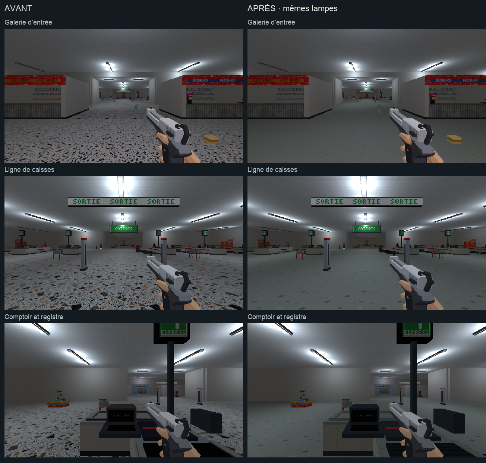

# Direction artistique — entrée et caisses du magasin

## Objectif

Commencer l’étape 3 [de l’audit](../journal/audit-direction-artistique-2026-10.md)
avec la galerie d’entrée et les six comptoirs. Le traitement prolonge
[l’étalon approuvé](etalon-direction-artistique.md), après
[les rames du métro](rame-direction-artistique.md).

[Ouvrir la revue en jeu](caisses-da.html).



[Comparer les tapis et les deux sols](caisses-da/details.png).
[Comparer avec l’étalon du quai](caisses-da/raccord-etalon.png).

## Traitement

- Terrazzo : fragments espacés, tons proches et quelques éclats sourds.
  La galerie conserve ses bandes de terrazzo fin et plus gros.
- Carrelage commercial : dalles de 50 cm, joints fins et variations sobres.
  Le changement de sol reste placé après la ligne de caisses.
- Passages : les sols entre parking, galerie et caisses prolongent le terrazzo.
- Comptoirs : stratifié ivoire, grain léger et lignes de panneaux espacées.
- Dessus et cornières : métal brossé clair, dans la famille du métal usiné
  du métro. Les UV répétées remplacent les anciens aplats et bandes d’atlas
  sur ces éléments sélectionnés.
- Registres, lecteurs et structures : plastique gris-bleu mat.
- Tapis : caoutchouc sombre avec de fines nervures transversales.

Les lampes, les plafonds, les murs, les proxies, les positions et les
produits conservent leur assemblage. Les rouges du magasin, les façades de
terminaux et les inscriptions restent présents. Les grands panneaux et
leurs répétitions appartiennent au lot de signalétique (DA-06).

Les sept textures utilisent 128×128 pixels pour 2 m, soit 64 texels/m.
Les surfaces de comptoir issues de la palette reçoivent des UV métriques ;
les faces de texte et les étiquettes conservent leurs coordonnées d’atlas.

## Reproduire

`tools/art_direction/store_checkout.py` sélectionne les cinq dalles de
la galerie et des caisses, les deux sols de raccord et onze éléments
par comptoir. Il construit les matières avec les recettes partagées de
`tools/art_direction/surface_recipes.py`.

`tools/blender/refresh_store_art_direction.py` applique cette passe au
magasin déjà construit. La première version du fichier est conservée dans
`renders/_cassandre/niveau_v2_avant_da.blend`. La retouche locale sauvegarde
le `.blend` et exporte le `.glb` contrôlé.

```sh
/Applications/Blender.app/Contents/MacOS/Blender \
  -b assets_src/blender/niveau_v2.blend \
  -P tools/blender/cassandre_cli.py -- art_direction_store
```

La reconstruction normale `tools/level_v2/build_niveau.py` et la retouche
locale des caisses `tools/blender/refresh_checkouts.py` appellent aussi
la recette avant leur sauvegarde. Le build complet du magasin n’est pas
relancé pendant cette passe locale.

Sorties : `assets_src/blender/niveau_v2.blend`,
`public/assets/levels/niveau_v2.glb` et
[manifeste de déploiement](caisses-da/deploiement.json).
73 meshes reçoivent les matières : 7 sols et 66 éléments de caisse.
L’export contrôlé contient 3 977 objets sans intrus de bibliothèque.

## Observation

La revue utilise le vrai niveau `niveau_v2`, en 640×360/aniso, avec
l’équipement type et un pistolet. Les ennemis restent visibles et sont
neutralisés pour regarder les matières. Ses [six poses](caisses-da/poses.json)
montrent l’entrée, l’ensemble, un comptoir, un tapis, le retour depuis les
rayons et la galerie.

Les captures avant et après utilisent les mêmes poses demandées, les
mêmes lampes et le même équipement. Les
[poses observées avant](caisses-da/poses-avant.json) et
[après](caisses-da/poses-apres.json) sont conservées avec les images.
Les captures montrent le monde sans les overlays du HUD.

Un déplacement de 0,5 s va de y=18 à y=22,3, z=0,01, depuis le raccord
vers les caisses. La [vue en marche](caisses-da/raccord-en-marche.png) et
[son relevé](caisses-da/deplacement.json) sont conservés.

Les [six vues Blender](caisses-da/blender.png) et les deux planches de
comparaison sont ouvertes et relues. Le rendu du jeu arbitre la lecture finale.

Aucune suite de tests automatisés n’est lancée. Cette observation ne remplace
pas un playtest des combats, une gate de console propre ou une mesure complète
de performance.

## Suite

L’étape 3 continue avec la surface de vente et son mobilier, puis les autres
locaux du magasin et la finition des véhicules. Les armes, les personnages
et les interactions ont leurs lots dédiés dans l’audit.
