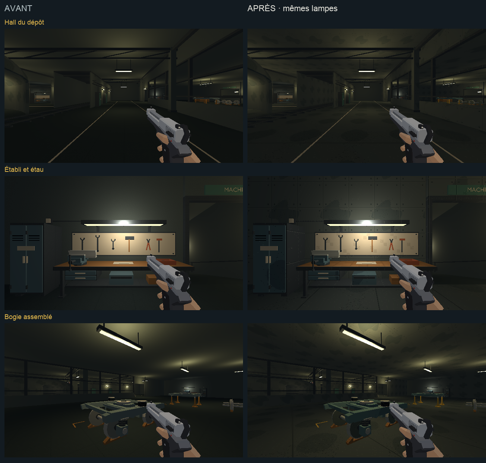

# Direction artistique — dépôt et ateliers

## Objectif

Prolonger [l'étalon approuvé](etalon-direction-artistique.md) dans le hall du
dépôt, les ateliers mécaniques et électriques, puis le quai de service.
Cette passe poursuit l'étape 2 de [l'audit](../journal/audit-direction-artistique-2026-10.md),
après [la billetterie et sa descente](billetterie-direction-artistique.md).

[Ouvrir la revue en jeu](depot-da.html).



[Comparer le moteur, l'atelier électrique et le quai de service](depot-da/ateliers.png).

## Traitement

- Sols : béton industriel sombre, avec joints espacés et variations larges,
  dans la continuité du sol des voies.
- Murs, plafonds et piliers : béton gris-vert, joints de coffrage et attaches.
- Charpente, réseaux et établis : acier peint et bois de la charte.
- Équipements : peintures bleues et gris-vert distinctes, métal usiné plus
  clair, parties sombres des roues et cuivre des composants électriques.
- Circulations et marches : marquages peints ; garde-corps, appuis et
  marquise prolongent les matières du dépôt.

Les textures répétées gardent 128×128 pour 2 m, soit 64 texels/m.
Chaque nouvelle rampe utilise quatre tons. Les motifs du métal usiné sont
plus discrets que les variations des grandes surfaces de béton.
Les positions, dimensions, proxies, parents de voyage et lampes restent
ceux du niveau existant. La rame de service conserve son traitement.

## Reproduire

`tools/art_direction/metro_depot.py` sélectionne les surfaces du groupe
`depot` réellement découpées et les kits `n5_depot_*`. Il remplace leurs
matériaux par ceux construits dans `metro_materials.py`. Les rampes des
équipements et les motifs correspondants rejoignent `surface_recipes.py`.
La recette fait partie de la reconstruction normale du métro.

```sh
/Applications/Blender.app/Contents/MacOS/Blender -b --factory-startup \
  -P tools/blender/cassandre_cli.py -- metro_blockout apercus=false
```

Sorties : `assets_src/blender/metro_blockout.blend`,
`public/assets/levels/metro_blockout.glb` et
[manifeste de déploiement](depot-da/deploiement.json).
66 meshes reçoivent les matières de cette passe. L'export contrôlé conserve
4 350 objets, sans intrus de bibliothèque.

## Observation

La revue utilise le niveau `metro`, en 640×360/aniso, avec l'équipement type
et un pistolet. Ses [six poses](depot-da/poses.json) couvrent le hall,
l'établi d'ajustage, le bogie, le moteur déposé, l'atelier électrique et les
marches d'embarquement. Les ennemis sont neutralisés et les trains suspendus
pour observer les surfaces. Le bouton de circulation rétablit les passages.

Les six captures de chaque version utilisent les mêmes poses demandées,
les mêmes lampes et le même équipement. Elles montrent le monde sans les
overlays du HUD. Les [six vues Blender](depot-da/blender.png), rendues en
Workbench texturé, et les deux planches de comparaison ont été ouvertes
et relues. L'éclairage du jeu arbitre la lecture finale.

Un déplacement de 0,5 s dans le hall va de y=333 à y=337,31, à z=−17,99.
La [vue après déplacement](depot-da/hall-en-marche.png) et
[son relevé](depot-da/deplacement.json) sont conservés.
Aucune suite de tests automatisés n'est lancée. Cette observation ne
remplace pas un playtest des combats ni une mesure de performance complète.

## Suite

[La machinerie et le poste d’aiguillage](technique-direction-artistique.md)
constituent la passe suivante.
La station privée, la remontée et le parvis de la tour viennent ensuite,
avec leur sous-palette froide.
