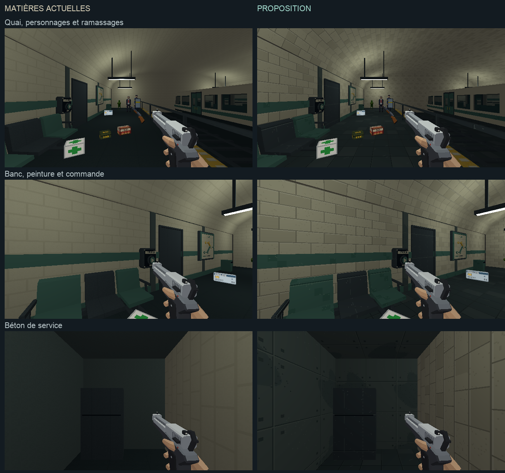

# Étalon de direction artistique — quai

Étape 1 de [l'audit](../journal/audit-direction-artistique-2026-10.md).
**Traitement approuvé par l'utilisateur le 10 octobre 2026.** La base
transversale est la [charte commune](../5-guides/direction-artistique.md).

[Ouvrir la comparaison jouable](etalon-da.html).



## Comparaison

Une station étalon de 18×16 m, avec quais de 5 m, voies, rame statique,
voûte, banc adossé, commande, rideau ouvrant et pièce de service. Trois
ennemis et les ramassages utilisent leurs systèmes actuels.

| Version | Contenu |
|---|---|
| Matières actuelles | Assemblage d'étalon avec les matières des bibliothèques existantes. Il ne reproduit pas toute la station du niveau de campagne. |
| Proposition | Même assemblage, avec carrelage nuancé, joints, traces sobres, peinture usée, acier, béton et sol retravaillés. |

Les lampes sont identiques dans les deux exports : six points ivoire/pétrole
de couleur `#dce5d4`, intensité 5, portée 12 m ; un point de service de même
couleur, intensité 1,5, portée 6 m. Le régime du jeu reste hybride, avec
ambiante à 0,18. Les aperçus Blender désactivent les ombres des lampes,
comme le renderer du jeu.

Les mains, armes, sprites, cartes et boîtes gardent leurs ressources
actuelles. Ils servent à juger ensemble les familles visuelles.

## Matières

Sept recettes de 128×128, avec UV métriques sur 2 m : ivoire, sol, béton,
acier, pétrole, bois et ambre. Le bois fait partie de la recette commune ;
le banc de ce premier étalon garde ses coques en peinture et acier.
Chaque recette dispose de quatre tons. Les motifs restent déterministes.

- Carrelage : variation par carreau, joint fin et arête claire choisie.
- Sol : dalles de 0,5 m, joints sobres et quelques traces de frottement.
- Béton : joints de panneaux, fixations, taches larges périodiques et
  quelques petits éclats. Une première version trop quadrillée est écartée.
- Peinture et acier : variation discrète, lignes d'assemblage et traces
  localisées. Ils conservent la famille pétrole/gris-bleu de la station.

Le relevé de palette et les poses se trouvent dans
[le manifeste](etalon-da/scene.json).

## Reproduire

La recette s'exécute dans une session Blender neuve :

```sh
/Applications/Blender.app/Contents/MacOS/Blender -b --factory-startup \
  -P tools/blender/cassandre_cli.py -- art_direction_quay
```

Sources : `tools/art_direction/quay_scene.py`, `surface_recipes.py`,
`assets_src/library/lib_metro_N3.blend` et `lib_quartier_N3b.blend`.
Les sources de campagne ne sont pas réécrites par cette recette.

Sorties : `assets_src/blender/etalon_da{_avant}.blend`,
`public/assets/levels/etalon_da{_avant}.glb`, les textures dans
`assets_src/library/art_direction/textures/` et le manifeste documentaire.
Les exports passent par `C.export()`, avec contrôle du contenu exporté.

Le registre de développement ajoute `etalon_da` et `etalon_da_avant`.
La page de comparaison utilise ces entrées avec l'équipement type, neutralise
les ennemis, pose la caméra et applique le rendu de référence 640×360/aniso
sans persister ces réglages. Les boutons choisissent la vue et l'arme.
« Actionner le rideau » replace le joueur devant la porte et utilise
la commande auteur du système normal de portes. La commande murale reste
utilisable avec E pendant le déplacement dans le jeu.

## Observation et suite

Les rendus Blender sont ouverts et regardés ; ils servent à relire
l'assemblage. Les captures en jeu montrent aussi les vrais sprites,
ramassages et viewmodels. La première passe de lampes saturait le pistolet ;
les valeurs communes ci-dessus conservent ses nuances.
Les trois cadrages de chaque version sont capturés en 640×360. Le
typecheck TypeScript passe ; aucune suite de tests automatisés n'est lancée.
Le changement pistolet/pompe est observé dans l'étalon. Le rideau atteint
l'état `open` et laisse voir le local : [capture de l'accès](etalon-da/service-ouvert.png).

Les skills `retro-fps-invariants`, `build-engine-look` et
`retro-texture-density` sont alignés sur les décisions courantes ; la
validation de la proposition artistique reste distincte.

L'avis du 10 octobre (« Je valide c'est très beau tu peux continuer »)
autorise l'étape 2 : [les galeries et le vestiaire](galerie-direction-artistique.md)
du métro. Les étapes suivantes de l'audit restent à faire.
