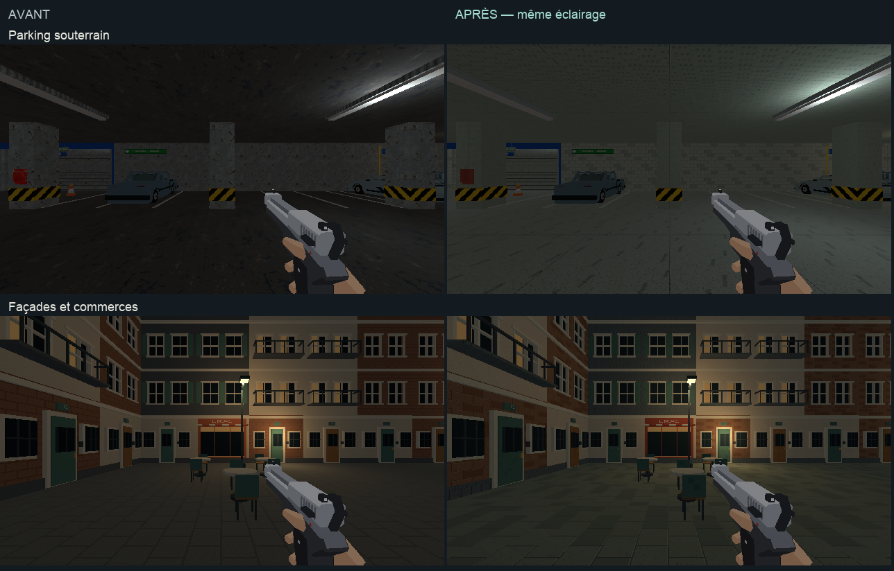

# Finition des décors du magasin et du quartier

## Périmètre

Cette passe termine le déploiement des matières sur les décors restants des
deux niveaux. Elle complète les passes locales déjà réalisées. L’arbitrage
artistique final reste celui de l’utilisateur.

| Niveau | Surfaces reprises | Meshes modifiés |
|---|---|---:|
| Magasin | Parkings, murs extérieurs, raccords, petits décors, laboratoire photo et passage technique | 693 |
| Magasin | Carrosseries, châssis et pièces de véhicules | 28 |
| Métro | Quartier, façades, pavés, mobilier et pièces restantes du décor | 1 218 |
| Métro | Habillage des commandes et boîtiers | 112 |
| Métro | Véhicules du quartier | 2 |

Les véhicules conservent leurs couleurs et leurs vitrages. Une texture neutre
multiplie les couleurs de sommets pour ajouter un grain discret. Les enduits,
briques, ardoises, pavés, bétons et tissus reçoivent des recettes propres.
Les textures répétées occupent 128 × 128 pixels pour 2 × 2 mètres.

L’éclairage du magasin reste celui restauré après le rejet de la proposition
plus sombre. Les lampes du métro, les motifs fonctionnels des atlas, les
géométries et les interactions restent ceux des zones déjà travaillées.
Les armes, personnages, illustrations, interface et effets conservent leurs
lots distincts dans [l’audit](../journal/audit-direction-artistique-2026-10.md).

## Revue visuelle

[Ouvrir la synthèse](finition-da.html), le
[magasin jouable](finition-magasin.html) ou le
[quartier jouable](finition-quartier.html).

Quatorze cadrages avant/après sont observés dans le jeu à 640 × 360, avec
leurs poses enregistrées. Deux vues après déplacement et deux planches
Blender complètent la revue. Ces observations portent sur les matières et
leurs raccords ; elles ne constituent pas un playtest complet des combats.

Le premier asphalte du parking est trop sombre. Sa rampe est éclaircie et
les murs de béton reçoivent des lignes de coffrage discrètes. La pose initiale
de la cour est remplacée car elle est masquée par un mur ; la vue retenue
montre l’accès de service et sa commande. La source des véhicules du métro
contient bien `Col`, mais ne le sélectionne pas comme attribut actif : la
recette rétablit cette sélection sans modifier ses valeurs.

## Sources et reprise

- `tools/art_direction/store_finish.py` traite le magasin après ses annexes.
- `tools/art_direction/metro_exteriors.py` traite le quartier et les pièces restantes du métro.
- `tools/art_direction/vehicle_finish.py` conserve la couleur de chaque véhicule.
- `tools/art_direction/surface_recipes.py` construit les matières et textures embarquées.
- `tools/art_direction/compose_finish.py` compose les planches depuis les captures.
- `tools/blender/refresh_art_direction_finish.py` applique la passe locale, sauvegarde et exporte.

Les builds normaux des deux niveaux rejouent ces traitements. La commande
`C.art_direction_finish(niveau="hypermarche")` ou
`C.art_direction_finish(niveau="metro")` les applique localement.
`inspect=True` produit uniquement un inventaire. Les objets déjà traités
portent `art_finish_family`, ce qui permet de reprendre la passe sans
réassigner les matières des zones voisines.

Les sources sont `assets_src/blender/niveau_v2.blend` et
`assets_src/blender/metro_blockout.blend`. Les exports utilisés par le jeu sont
`public/assets/levels/niveau_v2.glb` et
`public/assets/levels/metro_blockout.glb`. Leur export relève respectivement
4 003 et 4 356 objets, sans fuite de bibliothèque. Les sauvegardes avant cette
passe sont conservées dans `renders/_cassandre/`.

Les [inventaires](finition-da/inventaire-magasin.json),
[relevés du métro](finition-da/inventaire-metro.json),
[déploiement magasin](finition-da/deploiement-magasin.json) et
[déploiement métro](finition-da/deploiement-metro.json) détaillent les objets.

## Pour aller plus loin

[Charte commune](../5-guides/direction-artistique.md) ·
[Finitions des bureaux](bureaux-finitions.md) ·
[Annexes](annexes-direction-artistique.md)
