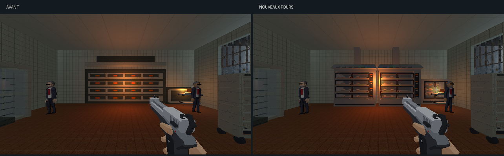
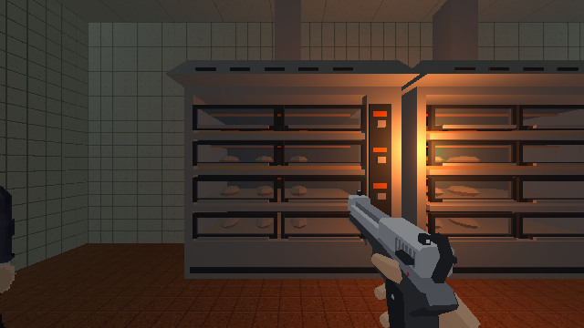
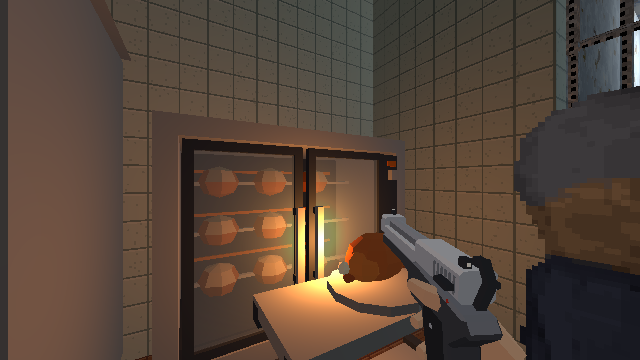

# Fours du fournil

## Objectif et référence

Le retour sur la [passe des ateliers](ateliers-direction-artistique.md) demande
des fours reconnaissables. L’ancienne façade ressemble à une armoire de six
mètres avec de petits rectangles orange.

La référence est le [four à soles Orion EvO de Bongard](https://www.bongard.fr/produit/four-a-soles-orion-evo/),
avec sa [photo constructeur](https://www.bongard.fr/wp-content/uploads/2018/12/four-a-sole-orionevo.jpg).
L’adaptation retient les chambres superposées, les larges vitres, les montants
inox, les poignées, la commande latérale et la hotte. Elle ne reproduit ni
le logo ni le modèle exact.

## Appareils proposés

- Deux modules de 2,82 m, à quatre étages, avec deux vitres par étage.
- Chambres réellement creuses, soles réfractaires et pains visibles.
- Portes vitrées à cadre sombre, poignées et commandes par étage.
- Hottes inclinées et conduits raccordés au plafond.
- Rôtissoire plus haute, avec deux portes vitrées, trois broches et un socle.

Le métal réutilise les textures d’inox et de noir des ateliers. Les petites
commandes et les aliments utilisent la palette existante. Le vitrage reste
transparent à 30 %, avec `solide: false` ; le volume de l’appareil fournit
la collision. Les vitrages et portes des fours sont fixes.

## Intégration et reprise

`tools/blender/lib_fournil_ovens.py` construit les deux appareils et leurs
trois proxies. `tools/level_v2/espaces/fournil.py` appelle cette bibliothèque
pendant le build normal. `tools/art_direction/store_workshops.py` connaît
leurs familles de matériaux.

La retouche locale retire les anciennes composantes des fours dans les
meshes partagés, puis reconstruit les appareils. Les tables, chariots,
chambre de pousse, nourriture ramassable et lampes restent en place.

```sh
blender -b assets_src/blender/niveau_v2.blend \
  -P tools/blender/cassandre_cli.py -- rework_fournil_ovens
```

La copie avant retouche est `renders/_cassandre/niveau_v2_avant_fours.blend`.
La source et le GLB sont sauvegardés ; l’export décrit 4 001 objets du view
layer, sans fuite de bibliothèque. Le [manifeste](fours-fournil/deploiement.json)
décrit les treize meshes visibles créés.

## Revue visuelle

[Ouvrir les quatre vues en jeu](fours-fournil.html).







Les [poses enregistrées](fours-fournil/poses-apres.json) utilisent la
résolution interne 640×360. Une [planche Blender](fours-fournil/blender.png)
et une [silhouette isolée](fours-fournil/silhouette.png) complètent les vues.
La lecture en jeu montre les pains et broches derrière le verre ; Workbench
affiche le vitrage opaque et sert seulement à lire les proportions.

Deux passages d’export aboutissent à la même liste de treize meshes visibles,
sans accumulation des appareils. Aucune suite de tests automatisés n’est lancée.
Le rendu est approuvé par l’utilisateur le 11 octobre 2026.
