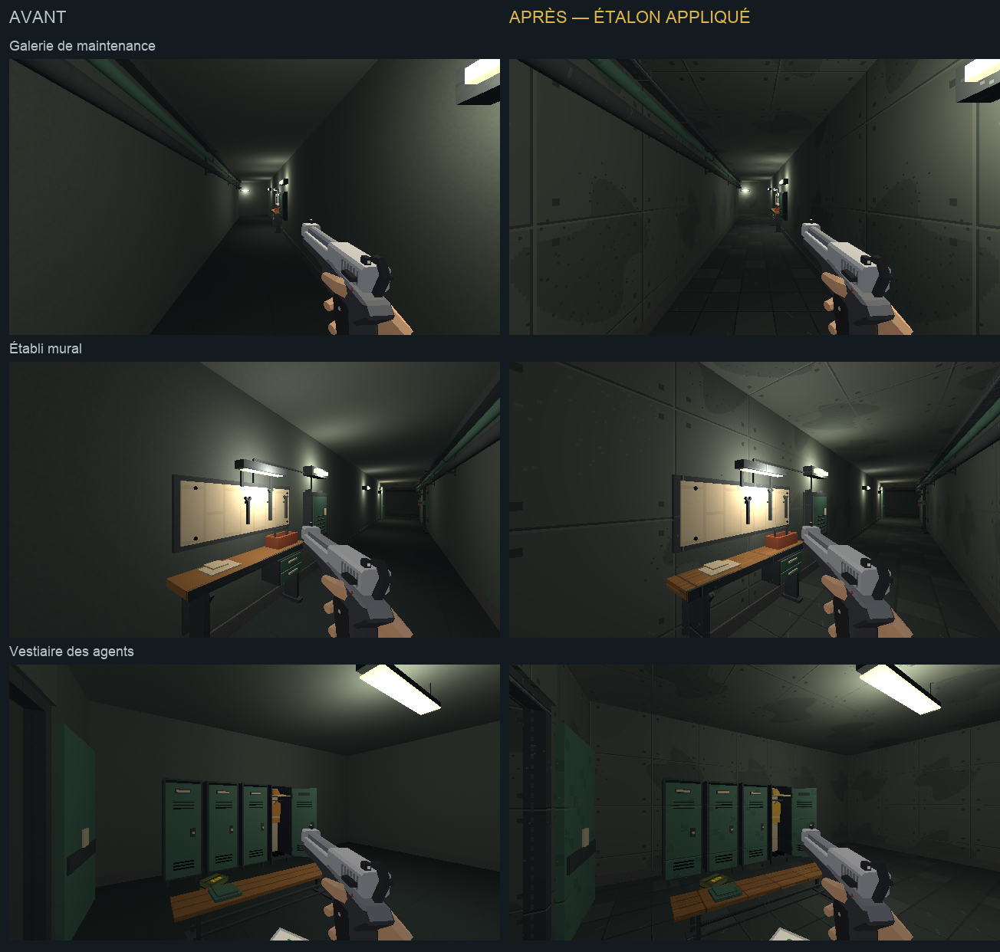

# Direction artistique — galeries et vestiaire

## Objectif

Première extension de [l'étalon approuvé](etalon-direction-artistique.md)
dans le métro jouable. Elle reprend les galeries de maintenance et leur
vestiaire, avec le passage qui les relie, en conservant les ambiances
lumineuses et les équipements existants.

[Ouvrir la revue en jeu](galerie-da.html).



## Traitement

- Béton : panneaux, joints fins, fixations et variations larges sobres.
- Sol : dalles de 0,5 m, joints et traces discrètes, UV métriques existants.
- Conduites, mains courantes et meubles : acier gris-bleu et peinture pétrole.
- Banc et établi : grain du bois, avec la même famille que l'étalon.
- Équipements ivoire : peinture mate, distincte du carrelage du quai.

Les sept textures font 128×128 pour une répétition de 2 m. Les cadrans,
papiers, lampes, pictogrammes et couleurs d'alerte gardent leurs matériaux.
La géométrie, les portes, proxies, apparitions et positions de ramassages
conservent leur définition. L'ensemble du réseau des galeries reçoit le
même traitement, jusqu'au retour vers le tunnel A ; les autres zones
du métro attendent leurs passes propres.

## Reproduire

`tools/art_direction/metro_gallery.py` sélectionne les objets par leur
identifiant de kit, puis remplace leurs matériaux. La construction des
matières est partagée avec la station dans `metro_materials.py`. Les matériaux communs
de la bibliothèque sont copiés ; les autres lieux ne sont pas recolorés.
La recette est appelée par `tools/metro/blockout/build_blockout.py` après
l'assemblage et avant la sauvegarde et l'export.

```sh
/Applications/Blender.app/Contents/MacOS/Blender -b --factory-startup \
  -P tools/blender/cassandre_cli.py -- metro_blockout apercus=false
```

Les sorties sont `assets_src/blender/metro_blockout.blend` et
`public/assets/levels/metro_blockout.glb`. Le relevé des objets et matières
est conservé dans [le manifeste de déploiement](galerie-da/deploiement.json).
Cette passe remplace les matériaux de 51 meshes visibles, dans sept
familles. L'export contrôlé contient 4 344 objets, comme avant la passe,
sans objet de bibliothèque exclue.

## Observation

La revue utilise le vrai niveau `metro`, son équipement type et un pistolet
au premier plan. Les captures utilisent les mêmes poses demandées en 640×360/aniso
et les mêmes lampes. Les attaques sont neutralisées pour l'observation.
L'aimant du profil type peut ramasser des cartouches à l'entrée du vestiaire.

Les captures du monde ne comprennent pas les overlays du HUD. Le bouton
de déplacement permet de relire les surfaces en mouvement ; cette revue
visuelle ne remplace pas un playtest des combats. Un déplacement de 0,5 s
est observé dans la première galerie : de x=10 à x=12,86, sans changer le cap.
La [vue après déplacement](galerie-da/galerie-en-marche.png) et
[son relevé](galerie-da/deplacement.json) sont conservés.
La [vue de l'accès](galerie-da/apres-acces.png) permet de relire le raccord
entre la galerie et les deux murs du passage vers le vestiaire.

Les [quatre rendus Blender](galerie-da/blender.png) sont ouverts et relus
en mode Workbench texturé, pour observer l'assemblage. Les images en jeu
servent à comparer la lumière réelle. Aucune suite de tests automatisés
n'est lancée pour cette passe.

## Suite

La passe suivante reprend [les quais et les tunnels](quais-direction-artistique.md).
Les autres pièces de service restent à traiter par famille, puis viennent
le magasin et les objets proches, suivant
[l'audit](../journal/audit-direction-artistique-2026-10.md#ordre-de-travail-recommandé).
