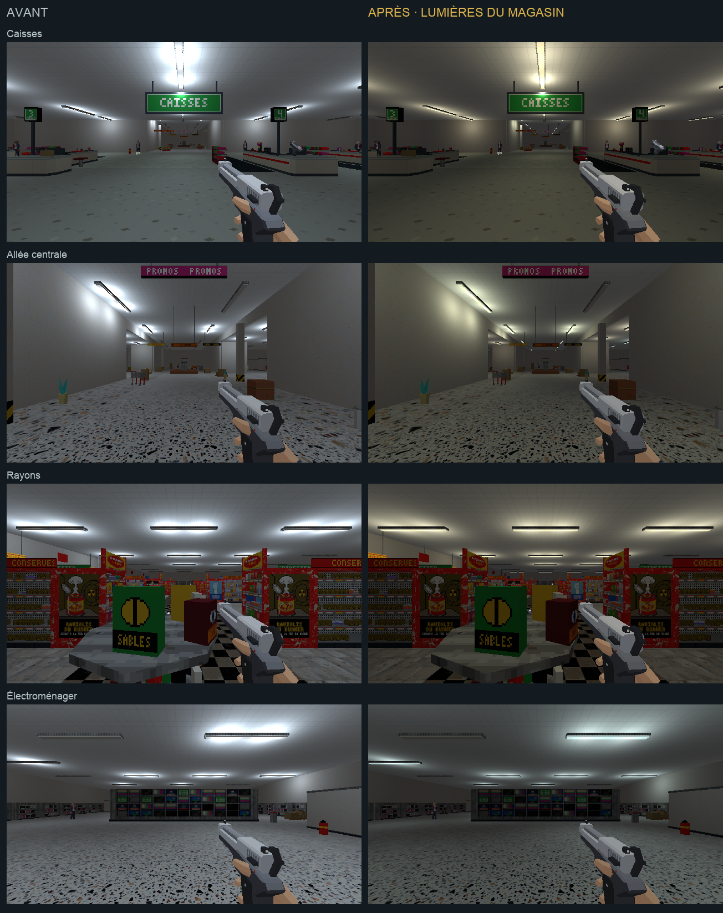
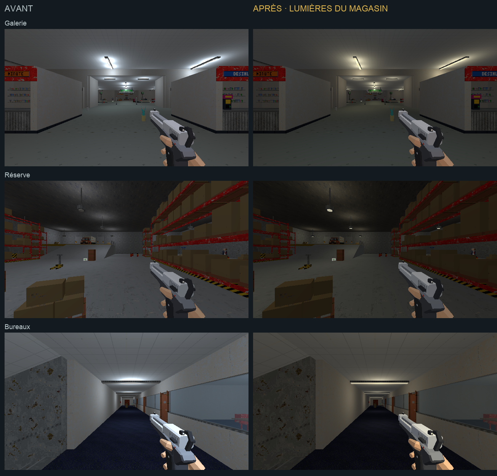
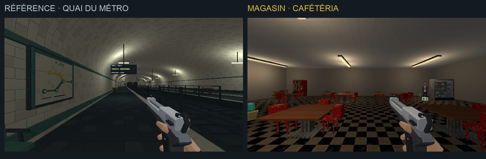
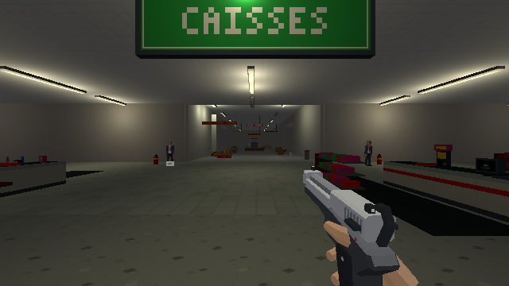

# Éclairage du magasin

> Proposition rejetée le 11 octobre : le magasin est jugé trop sombre.
> L’éclairage d’origine est restauré. La suite porte sur [les textures de la surface de vente](vente-direction-artistique.md).
> Les paramètres et fichiers décrits ci-dessous documentent l’essai historique ; ils ne sont plus déployés.

## Objectif

Sur demande de l’utilisateur, reprendre les lumières du magasin dans la
continuité du [métro](quais-direction-artistique.md). Cette passe suit
[les matières des caisses](caisses-direction-artistique.md).

[Ouvrir la revue en jeu](magasin-eclairage.html).

## Traitement

- Galerie et caisses : néons ivoire, portée resserrée et lune bleue aux verrières.
- Allée centrale et rayons : ivoire légèrement vert, ombres entre les rampes.
- Électroménager : blanc froid moins intense ; les écrans restent distincts.
- Cafétéria et direction : tons plus chauds.
- Réserve : suspensions ivoire à portée plus courte et disques lumineux visibles.
- Couloirs et bureaux : halos moins brûlés au plafond.

194 sources changent de teinte, d’intensité ou de portée. Leurs positions
restent associées aux luminaires : la source ponctuelle des tubes descend de
35 cm pour réduire la concentration de lumière sur le plafond. La recette
conserve l’altitude initiale et ne cumule pas ce déplacement lors des reprises.
Elle garde la hauteur initiale près des panneaux suspendus pour éviter qu’une
source traverse leur façade et crée un point brûlé.

137 tubes et disques utilisent des matériaux `store_lampe_*`. Leur émission
est transmise au Lambert à l’import. Les deux suspensions sans source et les
tubes morts restent éteints. Les 51 autres sources gardent leurs paramètres :
parking, surgelés, secours, fours, écrans et autres accents spécialisés.

L’ambiante du niveau magasin passe de 0,18 à 0,12. `ambientIntensity` dans
`LevelDef` permet ce réglage local ; les autres niveaux conservent leurs
valeurs par défaut. Ce réglage porte sur tout le niveau, parking compris.
Le pool et le nombre total de sources restent identiques.

## Sources et reprise

- `tools/art_direction/store_lighting.py` : profils et traitement des luminaires.
- `tools/blender/refresh_store_lighting.py` : retouche locale sauvegardée et export.
- `tools/level_v2/build_niveau.py` : application lors du prochain build.
- `tools/blender/refresh_checkouts.py` et `refresh_store_art_direction.py` :
  réapplication après les retouches locales des caisses et des matières.
- `src/render/environment/storeFixtures.ts` : émission des tubes et disques.
- `src/game/level/loading/levelPresentation.ts` : raccord à la conversion Lambert.
- `src/game/level/catalog/levels.ts` et `src/game/session/lifecycle.ts` : ambiante locale.

Commande : `C.store_lighting()`, ou `cassandre_cli.py -- store_lighting`
avec `niveau_v2.blend` ouvert. La copie avant éclairage est conservée dans
`renders/_cassandre/niveau_v2_avant_eclairage.blend`. La retouche locale est
exécutée ; les hooks de reconstruction sont ajoutés, sans reconstruire le niveau entier.

## Observation visuelle

La première proposition change les teintes et les portées. La seconde réduit
l’ambiante et éloigne les sources du plafond pour calmer les halos. Une dernière
correction conserve la hauteur de la source située près du panneau des caisses
pour supprimer le point brûlé sur sa face. Le résultat
est regardé dans Blender et dans le jeu à 640 × 360.

Sept vues utilisent les mêmes poses avant et après : galerie, caisses,
allée centrale, rayons, électroménager, réserve et bureaux. La pose initiale
de cafétéria se trouve sous le comptoir ; elle est remplacée par une vue
dégagée, présentée seule après retouche. Les poses et captures restent dans
`docs/assets/magasin-eclairage/`.

Un déplacement dans l’axe des caisses passe de y=24 à y=28,45 à z=0,01.
Les deux ennemis au fond restent visibles dans la capture.

L’export contrôlé contient 3 977 objets du view layer et aucune fuite de
bibliothèque. Il n’y a pas de suite de tests ni de validation formelle de
combat ou de performance dans cette passe. La proposition attend le retour
artistique de l’utilisateur.

## Suite

Reprendre la surface de vente et le mobilier commercial selon
[la charte](../5-guides/direction-artistique.md). Les sols des rayons et de
l’allée centrale conservent encore leurs anciennes matières ; leur contraste
sera traité dans cette passe de matières.
