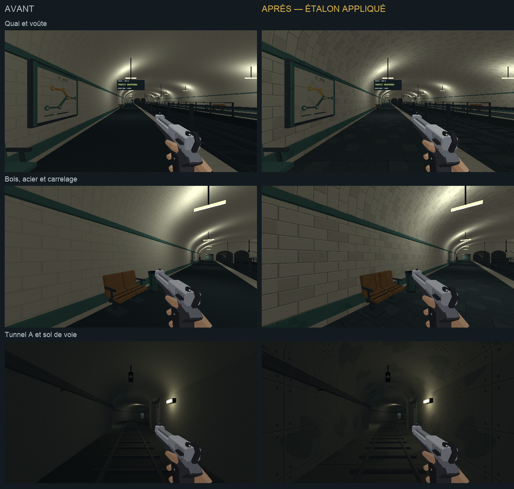

# Direction artistique — quais et tunnels

## Objectif

Poursuivre l'étape 2 de [l'audit](../journal/audit-direction-artistique-2026-10.md)
après [les galeries et le vestiaire](galerie-direction-artistique.md).
Les quais et les tunnels A/B reprennent les matières de
[l'étalon approuvé](etalon-direction-artistique.md), en gardant leurs
ambiances lumineuses et leurs circulations.

[Ouvrir la revue en jeu](quais-da.html).



[Comparer aussi la tête nord, le raccord des galeries et la branche B](quais-da/raccords.png).

## Traitement

- Station : carrelage ivoire nuancé sur les murs et la voûte, peinture pétrole
  des bandeaux, dalles sombres sur les quais.
- Mobilier : bois du banc, acier des appuis, peinture des sièges et corbeilles.
- Tunnels : béton de panneaux, variations larges et fixations sobres ; acier
  des rails et chemins de câbles.
- Voies : une recette de béton industriel sombre, avec pores, traces larges
  et joints transversaux. Elle se distingue des dalles piétonnes.
- Bord des quais : peinture ivoire distincte du carrelage. Les plans du réseau
  gardent un fond peint, sans motif de carreaux derrière leurs tracés.

Les matières répétées utilisent 128×128 pour 2 m. Les fonds fermés des
arrière-tunnels gardent leur matériau sombre, qui masque les apparitions
des trains. Cette passe concerne aussi les raccords et les arrière-tunnels
du réseau. Le train, la signalétique animée, les ennemis et les ramassages
gardent leurs ressources.

## Reproduire

`tools/art_direction/metro_materials.py` construit une fois les matières
partagées des galeries et de la station. `metro_gallery.py` et
`metro_station.py` les appliquent à leurs objets, sélectionnés par kit et
par les surfaces réellement découpées du plan.

`tools/metro/blockout/rail_architecture.py` sépare le matériau des bandes de
sécurité du carrelage, avant la consolidation. Les positions et dimensions
restent celles du niveau existant. Les couleurs, intensités et portées des
lampes ne sont pas retouchées.

```sh
/Applications/Blender.app/Contents/MacOS/Blender -b --factory-startup \
  -P tools/blender/cassandre_cli.py -- metro_blockout apercus=false
```

Les sorties sont `assets_src/blender/metro_blockout.blend` et
`public/assets/levels/metro_blockout.glb`. Le
[manifeste de déploiement](quais-da/deploiement.json) relève les objets et
matières de cette passe ; le manifeste des galeries reste séparé.
371 meshes reçoivent ces matières. Les galeries gardent leurs 51 meshes
traités. L'export contrôlé contient 4 345 objets : la séparation du bord
de quai ajoute un mesh consolidé par matériau, sans ajouter de géométrie.
Le contrôle d'export confirme l'absence d'objets des bibliothèques exclues.

## Observation

Les [poses de revue](quais-da/poses.json) couvrent le quai, le mobilier, la
tête nord, le tunnel A, le raccord des galeries et la branche B. La page
utilise le vrai niveau `metro`, en 640×360/aniso avec l'équipement type et
un pistolet. Les captures représentent le monde sans les overlays du HUD.

Les attaques et le trafic sont suspendus pour la comparaison. Cela affiche
« trafic suspendu » sur les écrans ; le bouton de reprise rétablit les
voies initialement actives via les commandes auteur du système normal.
Ce réglage de revue ne modifie pas la campagne.

Les [six rendus Blender](quais-da/blender.png) sont ouverts et relus en
Workbench texturé. Les six captures en jeu de chaque version comparent
les mêmes poses demandées avec les mêmes lampes. Un déplacement de
0,5 s dans le tunnel A est observé, de y=207 à y=209,26 :
[capture](quais-da/tunnel-en-marche.png) et [relevé](quais-da/deplacement.json).
Aucune suite de tests automatisés n'est lancée pour cette passe.

Cette passe visuelle ne remplace pas un playtest des combats et ne clôture
pas l'harmonisation complète du métro.

## Suite

La passe suivante reprend [la billetterie et la descente](billetterie-direction-artistique.md).
Le dépôt, la machinerie et la station privée attendent leurs passes.
Les grands panneaux et les interactions ont aussi un lot propre dans l'audit.
