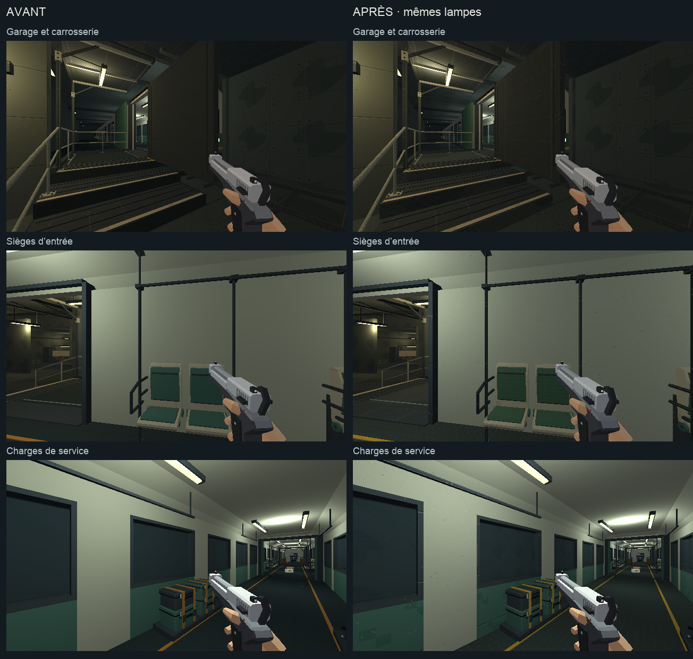

# Direction artistique — rames du métro

## Objectif

Prolonger [l’étalon approuvé](etalon-direction-artistique.md) dans la rame de
service, son garage et les voitures de trafic. Cette passe poursuit l’étape 2
[de l’audit](../journal/audit-direction-artistique-2026-10.md), après
[la station privée et le parvis](arrivee-direction-artistique.md).

[Ouvrir la revue en jeu](rame-da.html).



[Comparer les câbles, les banquettes et le pupitre](rame-da/interieur.png).

## Traitement

- Carrosserie et plafond : peinture claire légèrement verte, grain discret.
- Coussins : tissu vert à trame fine, distinct des coques et des articulations.
- Sol intérieur : caoutchouc sombre à petits reliefs antidérapants.
- Enrouleurs : câble en caoutchouc sombre, flasques métalliques et ambre.
- Charges et pupitre : peintures pétrole, acier et détails ambre de la charte.
- Garage : béton et sol industriel communs au dépôt.
- Rames de passage : mêmes peintures claires, pétrole et acier ; leurs
  vitrages, lampes et inscriptions conservent leur traitement.
- Suspentes des signaux : acier commun aux équipements du métro.

Les quatre recettes propres aux rames emploient 128×128 pixels pour 2 m,
soit 64 texels/m. Les tons intermédiaires du tissu et du caoutchouc restent
proches pour limiter le contraste des petits motifs à la résolution du jeu.
Les formes, portes, positions, proxies et lampes suivent l’assemblage existant.
La séparation du tissu et des câbles ajoute deux meshes de décor consolidé.

## Reproduire

`tools/art_direction/metro_service.py` sélectionne les supports du groupe
`fret`, les kits `n5_fret_*`, les deux portes de la rame, les enfants du
modèle de trafic et les suspentes des signaux. Les matériaux de la
bibliothèque de trafic sont chargés séparément : la correspondance utilise
leurs noms de famille à l’intérieur de ce modèle uniquement.

`metro_materials.py` construit les rampes et les recettes de
`surface_recipes.py`. `freight_entry_seating.py` et
`freight_service_cargo.py` séparent les coussins et les câbles avant la
consolidation des kits. Le sol intérieur reçoit le caoutchouc ; celui du
garage conserve sa dalle industrielle.

```sh
/Applications/Blender.app/Contents/MacOS/Blender -b --factory-startup \
  -P tools/blender/cassandre_cli.py -- metro_blockout apercus=false
```

Sorties : `assets_src/blender/metro_blockout.blend`,
`public/assets/levels/metro_blockout.glb` et
[manifeste de déploiement](rame-da/deploiement.json).
273 meshes reçoivent les matières : 69 pour la rame de service et le garage,
189 pour le modèle de trafic, 15 pour les suspentes.
L’export contrôlé contient 4 352 objets sans intrus de bibliothèque.

## Observation

La revue utilise le vrai niveau `metro`, en 640×360/aniso, avec l’équipement
type et un pistolet. Ses [six poses](rame-da/poses.json) couvrent le garage,
les sièges d’entrée, les charges, les enrouleurs, les banquettes d’équipe
et le pupitre. Les mêmes poses demandées et les mêmes lampes sont utilisées
avant et après. Les captures montrent le monde sans les overlays du HUD.
Les [poses observées avant](rame-da/poses-avant.json) et
[après](rame-da/poses-apres.json) accompagnent les images.

Les deux planches de comparaison sont ouvertes et relues, ainsi que les
[six vues Blender](rame-da/blender.png) utilisent Workbench texturé et
`sheet(..., voyage="depart")`, pour isoler le décor d’embarquement.
Le rendu en jeu arbitre la lecture des surfaces.

La page propose aussi une vue des rames de passage et un voyage de revue.
Le [train capturé au quai](rame-da/rame-au-quai.png) montre les mêmes
peintures sur les voitures de ligne. Le voyage de revue actionne avec E l’aiguillage, le courant et le départ, raccourcit
le trajet à 10 s, puis rétablit la configuration. La durée du voyage de
campagne n’est pas modifiée dans les sources du jeu.
La [capture en ligne](rame-da/voyage-en-ligne.png) intervient à 3,1 s,
phase `cruising`, vitesse 24 m/s. Le [relevé associé](rame-da/voyage-en-ligne.json)
et la [vue après arrivée](rame-da/voyage-arrivee.png) sont conservés.
Le [relevé final](rame-da/voyage-arrivee.json) indique `arrived`, une vitesse
nulle et une configuration rétablie à 60 s, accélération et freinage à 6 s.

La console confirme le chargement de 1 335 colliders et 188 lampes. Une
erreur `MutationObserver.observe` sans source est présente dans la session
de revue ; aucun verdict de console entièrement propre n’est prononcé.

Aucune suite de tests automatisés n’est lancée. Ces vues ne remplacent pas
un playtest de combat ni une mesure de performance complète.

## Suite

Les matières du métro ont reçu leurs passes par zone. Les interactions et
la signalétique gardent leur lot dédié. Le prochain lot de matières concerne
le magasin, le quartier extérieur et les objets que le joueur approche.
[La galerie d’entrée et les caisses](caisses-direction-artistique.md)
constituent la première passe de ce lot.
