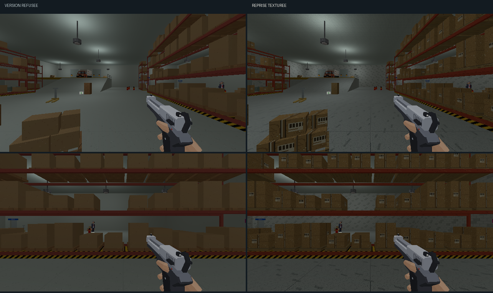

# Direction artistique — réserve et quai de livraison

## Objectif

La première proposition est refusée : la réserve semble sans texture et triste.
Cette reprise donne aux grandes surfaces et aux stocks une matière lisible,
dans la continuité de l’[étalon approuvé](etalon-direction-artistique.md).
[Ouvrir la revue](reserve-da.html).



[Comparer les parois et le quai](reserve-da/details.png).

## Matières

| Famille | Traitement |
|---|---|
| Sol, plateforme et rampe | Béton clair, joints de dalle de 2 m, grain et traces de manutention irrégulières. |
| Parois | Parpaings peints clairs de 50 × 25 cm, joints décalés et nuances par bloc. |
| Plafond | Béton de coffrage, joints, marques de fixation et grain. |
| Racks | Rouge brique plus franc, rayures et usure ponctuelle. |
| Palettes | Bois veiné, séparations de lattes et fixations sombres. |
| Cartons | Papier kraft, ruban adhésif, plis et étiquettes avec codes-barres. |
| Rideaux | Lames métalliques horizontales. |
| Fûts | Peinture kaki, cerclages et petites étiquettes. |
| Transpalettes | Fourches ambre et timon métallique. |

La recette traite 3 sols, 18 éléments de paroi, 1 plafond et 55 meshes de
mobilier : 77 meshes et dix familles de textures. Les textures de 128×128
couvrent 2 m, soit 64 texels/m. Les UV des cartons sont centrées sur chaque
boîte du mesh assemblé : le ruban et l’étiquette suivent l’objet.

Les textures de rouge, bois et carton sont propres à la réserve. Leurs
motifs ne remplacent pas ceux de la surface de vente. La passe garde
l’éclairage restauré du magasin, les atlas fonctionnels, le camion et les
propriétés des interactions.

## Reprise

`tools/art_direction/store_reserve.py` sélectionne les surfaces par nom et
matériau. `tools/art_direction/surface_recipes.py` produit leurs motifs.
Le build normal appelle la recette après les sanitaires.

```sh
blender -b assets_src/blender/niveau_v2.blend \
  -P tools/blender/cassandre_cli.py -- art_direction_reserve inspect=true
blender -b assets_src/blender/niveau_v2.blend \
  -P tools/blender/cassandre_cli.py -- art_direction_reserve
```

La retouche sauvegarde la source et exporte le niveau : 3 988 objets, sans
intrus de bibliothèque. [Inventaire](reserve-da/inventaire.json) et
[manifeste des matières](reserve-da/deploiement.json).
La copie originale reste dans `renders/_cassandre/niveau_v2_avant_reserve_da.blend` ;
la version refusée dans `renders/_cassandre/niveau_v2_reserve_refusee.blend`.
Les quatre captures `*-avant.png` gardent l’état original ; `*-refusee.png`
gardent la version lisse et `*-apres.png` montrent la reprise courante.

## Revue

Les [quatre poses](reserve-da/poses.json) montrent l’entrée, les racks,
les parois près des fûts et le quai. Les comparaisons gardent le même
éclairage et le rendu 640×360. La [planche Blender](reserve-da/blender.png)
complète les vues du jeu.

Le premier essai de la reprise rend les matériaux lisibles, mais le sol
présente un semis de points trop régulier. Le second remplace ce motif
par du grain et des traces irrégulières. Les rendus sont ouverts et relus.
La [vue après déplacement](reserve-da/en-marche.png) montre aussi les
surfaces de l’allée centrale.

Aucune suite de tests automatisés n’est lancée. La reprise est approuvée par l’utilisateur le 11 octobre : « C’est bien mieux ».
La suite concerne les [locaux du personnel et bureaux](bureaux-direction-artistique.md).
