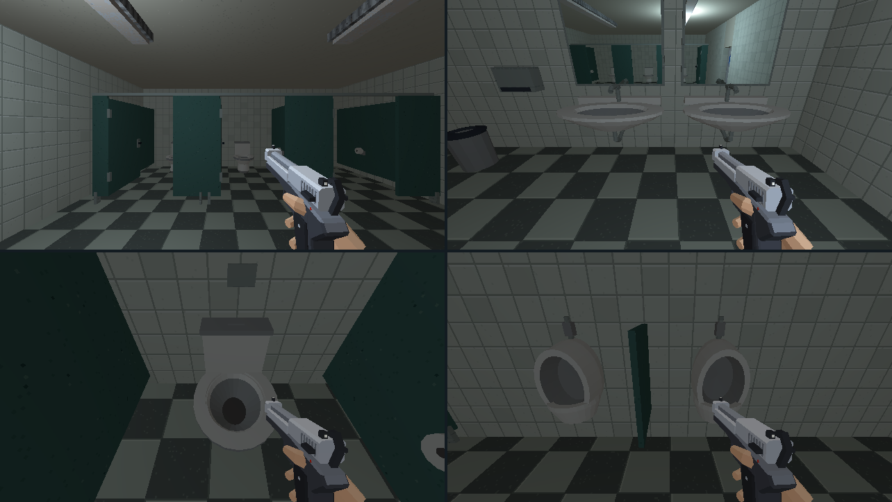

# Nouveaux équipements des sanitaires

## Objectif

Reprendre le mobilier après la [passe de matières](sanitaires-direction-artistique.md),
à la demande de l’utilisateur, avant de poursuivre la réserve.
[Ouvrir la revue en jeu](sanitaires-assets.html).



## Équipements

| Élément | Assemblage |
|---|---|
| Trois cabines | Largeur intérieure minimale 2,20 m, profondeur 2,87 m, passage de porte 1,30 m. Cloisons, pieds et lisse métallique. |
| Portes | Vantaux de 2 m, charnières, poignée et verrou. Ouvertes au départ ; `E` les ouvre et les ferme. |
| Deux lavabos | Vasques ovales creusées de 1,44 m de large, rebord, bonde, robinet et siphon apparent. |
| Trois cuvettes | Pied et cuvette arrondis, anneau de siège distinct, réservoir et bouton de chasse. Porte-papier dans chaque cabine. |
| Deux urinoirs | Dos creusé et vasque inférieure, bonde et arrivée d’eau. Séparation centrale. |
| Deux miroirs | Surface de 1,36 × 1,13 m, cadre métallique et reflet dynamique de la pièce. |

Les matières restent celles de la charte : faïence ivoire, stratifié vert
pétrole et métal mat. La céramique utilise la palette commune.
Le sol partagé, les murs de la pièce, sa porte d’accès et ses lampes gardent
leur assemblage. Les nouveaux passages et équipements ont leurs proxies de
collision ; les cuvettes et urinoirs conservent leur contrat `sanitaire_*`
(un mesh, un matériau, `sorte`, `pv: 50`).

## Reflets

Les panneaux `wc_miroir0` et `wc_miroir1` portent `miroir: true`.
Le [rendu au chargement](../4-technique/chargement-de-niveau.md#miroirs)
installe un reflet plan par surface, à 640×360 avec agrandissement nearest.
Les reflets suivent le déplacement et montrent la pièce, ses meubles et ses
lampes. Les armes en vue subjective et les autres miroirs sont cachés dans
le passage réfléchi. Il n’existe pas de corps complet du héros dans la scène.

Les shaders des reflets sont amorcés pendant le chargement.
L’implémentation utilise le [Reflector officiel de Three.js](https://threejs.org/docs/pages/Reflector.html).
La planche Blender montre les panneaux de pose gris ; le reflet est installé
par le runtime et se juge dans le jeu.

## Sources et reprise

- `tools/blender/lib_restrooms.py` : géométrie des équipements, UV de palette et portes.
- `tools/level_v2/espaces/toilettes.py` : raccord au build normal, plafond et lampes.
- `tools/art_direction/store_restrooms.py` : faïence, stratifié et métaux communs.
- `tools/blender/refresh_restroom_assets.py` : remplacement local, sauvegarde et export.
- `src/render/environment/levelMirrors.ts` : installation, passage réfléchi et libération.
- `src/render/environment/warmLevelMirrors.ts` : préparation pendant le chargement.

```sh
blender -b assets_src/blender/niveau_v2.blend \
  -P tools/blender/cassandre_cli.py -- rework_restrooms
```

La sauvegarde avant refonte est conservée dans
`renders/_cassandre/niveau_v2_avant_sanitaires_assets.blend`.
Le [manifeste de déploiement](sanitaires-assets/deploiement.json) accompagne
la source `.blend` et le fichier runtime `niveau_v2.glb`.
L’export contrôlé contient 3 988 objets sans intrus de bibliothèque.
Le build complet n’est pas relancé lors de cette retouche locale.

## Observation en jeu

Les [poses de revue](sanitaires-assets/poses.json) accompagnent les captures
sans overlays. Les vues de détail baissent temporairement la caméra de
22,5° pour les lavabos et urinoirs, et de 45° dans les cabines.
Les relevés de déplacement gardent la pose de jeu avant cet angle de capture.

Après 0,4 s d’avance depuis y=11,60, le joueur entre dans les trois cabines
et atteint y=14,26, devant la cuvette :
[1](sanitaires-assets/cabine-1.json), [2](sanitaires-assets/cabine-2.json),
[3](sanitaires-assets/cabine-3.json).
La [porte fermée](sanitaires-assets/porte-fermee.png) arrête le déplacement
à y=12,34 ; l’ouverture permet à nouveau de passer.

Le [reflet après déplacement](sanitaires-assets/miroirs-en-marche.png)
change avec la perspective. Le [relevé](sanitaires-assets/miroirs-en-marche.json)
place le joueur à x=58,55, y=7,63, devant les vasques.
Les captures du jeu et la [planche Blender](sanitaires-assets/blender.png)
sont ouvertes et relues après les révisions de forme et de palette.

La dernière ouverture de l’aperçu ne remonte aucune erreur ni avertissement
([relevé console](sanitaires-assets/console.json)). Les
[rechargements précédents](sanitaires-assets/console-rechargements.json)
contiennent deux erreurs `MutationObserver` sans origine renseignée ; cet
appel n’apparaît pas dans le code de l’application. Aucun échec de chargement
ou de shader n’est observé dans la revue finale.
Aucune suite de tests automatisés n’est lancée.

La refonte attend le retour visuel de l’utilisateur avant de reprendre la réserve.
