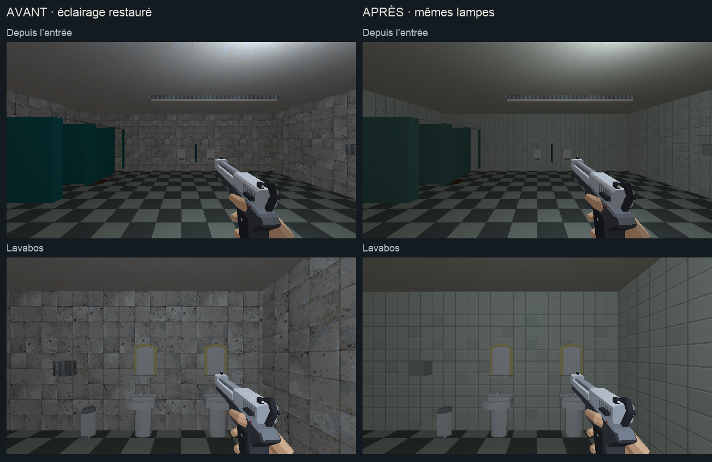

# Direction artistique — sanitaires du magasin

> La passe de matières ci-dessous précède la [refonte des équipements](sanitaires-assets.md), demandée ensuite par l’utilisateur. Les anciens meubles et vantaux sont remplacés.

## Objectif

Poursuivre l’étape 3 [de l’audit](../journal/audit-direction-artistique-2026-10.md)
après [la cafétéria](cafeteria-direction-artistique.md), dans les toilettes
attenantes. L’éclairage d’origine reste en place.

[Ouvrir la revue en jeu](sanitaires-da.html).



[Comparer les cabines et les urinoirs](sanitaires-da/details.png).

## Traitement

- Faïence des murs : carreaux ivoire de 25 cm, joints fins et peu de
  variations entre les carreaux. Les anciennes taches contrastées disparaissent.
- Cabines : stratifié vert pétrole, reprenant la rampe commune de l’étalon
  du métro avec un grain discret. Les vantaux gardent leur orientation.
- Lisse, tuyaux, plaque de chasse et sèche-mains : métal mat commun au magasin.
- Plafond : enduit ivoire de la cafétéria, sans les anciens éclats contrastés.

La sélection comprend 5 murs, 1 plafond, 5 éléments de cabine et
4 éléments métalliques, soit 15 meshes. Les quatre textures utilisent
128×128 pixels pour 2 m et des UV métriques.

Le sol est un mesh partagé avec la cafétéria : son nouveau damier est déjà
déployé lors de la passe précédente et reste en place. Les lavabos, miroirs,
cuvettes et urinoirs conservent leurs nuances de palette. Les appareils
`sanitaire_*` gardent leur mesh unique, leur matériau unique et leurs extras.
La porte, les lampes et les colliders conservent leur assemblage.

## Reproduire

`tools/art_direction/store_restrooms.py` sélectionne les éléments nommés
de la pièce, sans remplacer les matières partagées ailleurs.
`tools/art_direction/surface_recipes.py` contient les recettes répétées.
`tools/blender/refresh_store_restrooms.py` sauvegarde la source et exporte
le niveau contrôlé. La copie avant la passe est conservée dans
`renders/_cassandre/niveau_v2_avant_sanitaires_da.blend`.

```sh
/Applications/Blender.app/Contents/MacOS/Blender \
  -b assets_src/blender/niveau_v2.blend \
  -P tools/blender/cassandre_cli.py -- art_direction_restrooms
```

La reconstruction normale `tools/level_v2/build_niveau.py` appelle cette
recette après celle de la cafétéria. Le build complet n’est pas relancé
pendant cette retouche locale.

Sorties : `assets_src/blender/niveau_v2.blend`,
`public/assets/levels/niveau_v2.glb` et
[manifeste des matières](sanitaires-da/deploiement.json).
L’export contrôlé contient 3 977 objets, sans intrus de bibliothèque.

## Observation

Les [quatre poses](sanitaires-da/poses.json) montrent l’entrée, les lavabos,
les cabines et les urinoirs. Les images en 640×360/aniso utilisent les mêmes
lampes et le même pistolet. Les relevés [avant](sanitaires-da/poses-avant.json)
et [après](sanitaires-da/poses-apres.json) accompagnent les captures du monde
sans les overlays.

Un déplacement demandé de 0,5 s avance de x=57 à x=61,31, y=11, z=0,01.
La [vue après déplacement](sanitaires-da/en-marche.png) et
[son relevé](sanitaires-da/deplacement.json) sont conservés.
Les [quatre vues Blender](sanitaires-da/blender.png), les comparaisons et
la vue après déplacement sont ouvertes et relues. Le jeu arbitre la lecture.

Aucune suite de tests automatisés n’est lancée. Cette revue ne vaut pas
contrôle complet des interactions ni mesure de performance.
L’arbitrage artistique reste celui de l’utilisateur.

## Suite

La prochaine passe locale concerne la réserve et son mobilier de stockage,
avant les autres zones de service du magasin.
