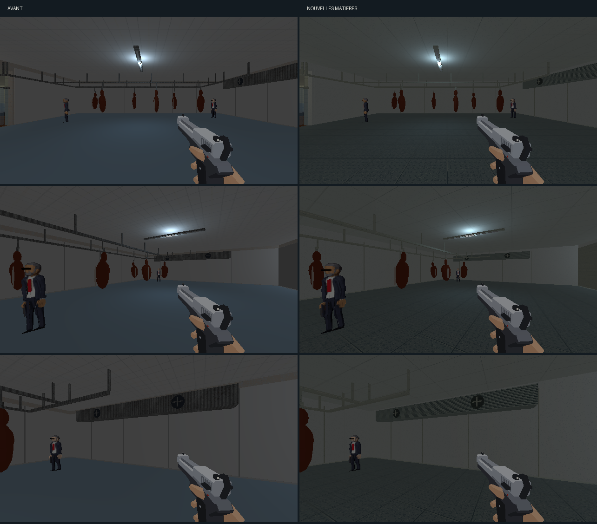
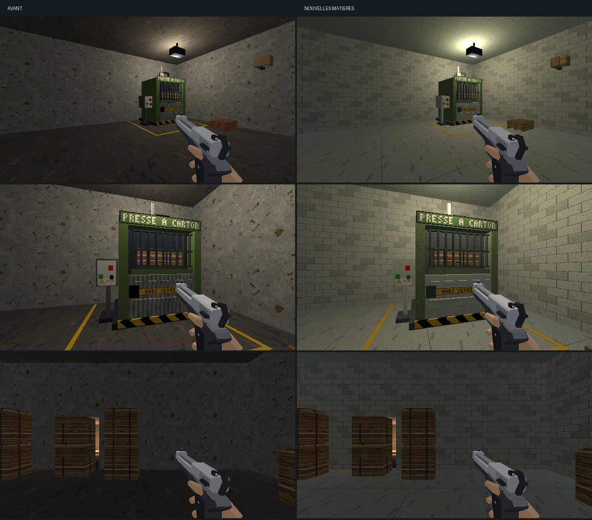

# Direction artistique — chambre froide et compacteur

## Objectif

Prolonger la [passe des ateliers](ateliers-direction-artistique.md) après
validation des [fours](fours-fournil.md). Les matières suivent la
[charte commune](../5-guides/direction-artistique.md) et réutilisent celles
de la réserve. [Ouvrir les six vues en jeu](service-da.html).

## Matières

| Zone et surface | Traitement |
|---|---|
| Chambre froide — sol | Revêtement gris-bleu à grain et relief antidérapant peint, joints de 1 m. |
| Panneaux isolants | Émail clair légèrement froid, raccords et traces discrètes. |
| Plafond frigorifique | Panneaux de 2 × 1 m, distincts des carrés du sol. |
| Évaporateur | Ailettes horizontales peintes ; ventilateurs conservés. |
| Rails et crochets | Inox brossé des ateliers. |
| Compacteur — sol et plafond | Béton de la réserve, avec deux rampes et motifs distincts. |
| Murs du compacteur | Blocs peints de la réserve. |
| Presse et benne | Peinture verte marquée, acier et pièces noires aux textures communes. |
| Palettes et carton de caméra | Bois et carton de la réserve. |

La passe concerne 51 meshes : 3 surfaces de sol (la chambre froide possède
un parement), 20 éléments de paroi, 2 plafonds et 26 éléments de mobilier.
Quinze familles de 128×128 couvrent 2 m, à 64 texels/m.

La presse, la benne et le cadre de porte partagent initialement leurs couleurs
dans une palette. La recette répartit leurs faces entre matériaux ; les
faces de boutons conservent leurs couleurs et UV. La porte frigorifique garde
son matériau unique. Les plaques et bandes de danger, balles de carton
compressé ou mal cerclé, carcasses, gras, vitrage PVC et tube lumineux
conservent leurs atlas et matériaux.

## Intégration

`tools/art_direction/store_service.py` sélectionne les surfaces par nom.
`tools/art_direction/surface_recipes.py` produit les cinq recettes froides et
la peinture industrielle. Le build normal rejoue cette passe après les ateliers.

```sh
blender -b assets_src/blender/niveau_v2.blend \
  -P tools/blender/cassandre_cli.py -- art_direction_service inspect=true
blender -b assets_src/blender/niveau_v2.blend \
  -P tools/blender/cassandre_cli.py -- art_direction_service
```

L’[inventaire](service-da/inventaire.json) inclut les voisins proches ; le
[manifeste](service-da/deploiement.json) décrit la sélection réelle.
La source et l’export sont sauvegardés. L’export décrit 4 001 objets du view
layer, sans fuite de bibliothèque. La copie avant retouche reste dans
`renders/_cassandre/niveau_v2_avant_service_da.blend`.

L’éclairage et les colliders conservent leurs valeurs. Aucun module runtime
n’est modifié. Les deux balles cassables devant la planque gardent leurs
propriétés ; l’accès au secret conserve son fonctionnement.

## Revue





Les [six poses](service-da/poses.json) et leurs relevés
[avant](service-da/poses-avant.json) / [après](service-da/poses-apres.json)
utilisent la résolution interne 640×360. Les captures du jeu et la
[planche Blender](service-da/blender.png) sont ouvertes et relues.

Le premier passage assombrit trop les parois froides. Le second rapproche
leur valeur de celle de l’émail d’origine et éclaircit le plafond. La texture
de l’évaporateur reçoit des ailettes pour rester identifiable. Les vues de
l’essai sont conservées sous `*-essai.png`.

Aucune suite de tests automatisés n’est lancée. L’utilisateur approuve
la proposition le 11 octobre et demande la suite.
