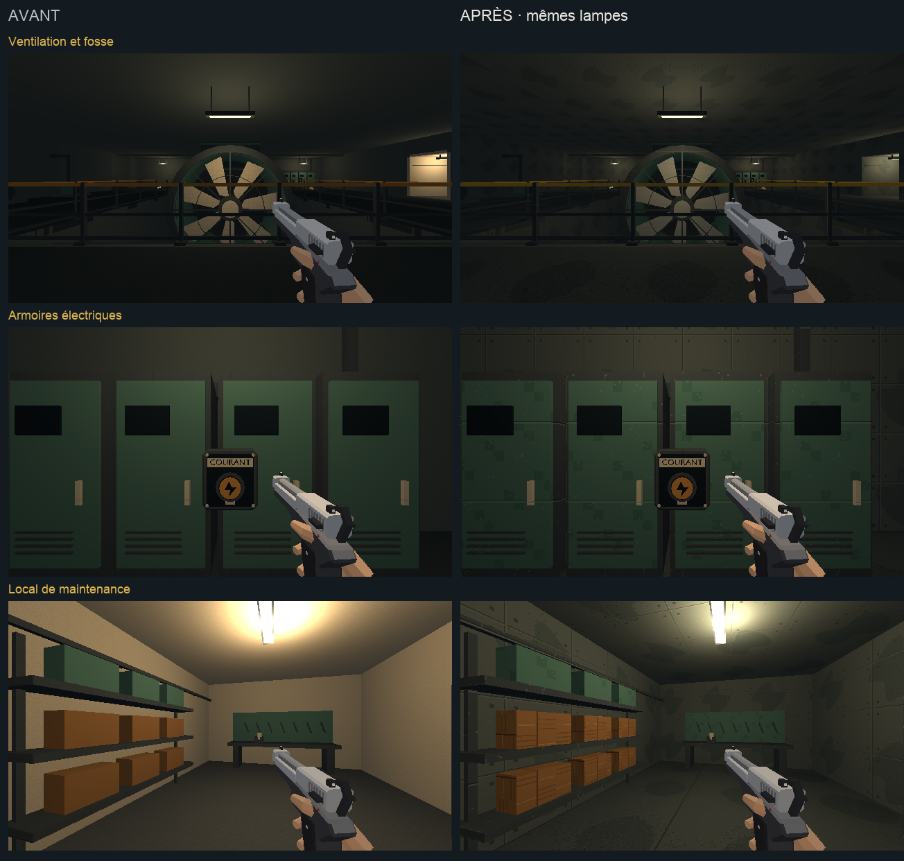

# Direction artistique — machinerie et aiguillage

## Objectif

Prolonger [la finition du dépôt](depot-direction-artistique.md) dans la
machinerie, son local d'entretien et le poste d'aiguillage. Cette passe
poursuit l'étape 2 de [l'audit](../journal/audit-direction-artistique-2026-10.md)
et reprend [l'étalon approuvé](etalon-direction-artistique.md).

[Ouvrir la revue en jeu](technique-da.html).



[Comparer les rampes et le poste d'aiguillage](technique-da/acces.png).

## Traitement

- Machinerie : béton gris-vert, sol industriel, charpente et conduites en
  acier, peintures pétrole sur les armoires et les équipements.
- Ventilation : pales et moyeu en métal usiné, dans la continuité des pièces
  mécaniques du dépôt ; cuvelage, sol de fosse et garde-corps harmonisés.
- Local d'entretien : béton et sol industriel, étagères en acier, pièces
  peintes et caisses en bois. Le raccord au local reçoit les mêmes matières.
- Poste d'aiguillage : murs et plafond peints en ivoire, avec un grain
  fin et discret, dalles sombres,
  pupitre pétrole et acier, mobilier en bois et repères ambre.
- Accès : rampes et escalier prolongent les familles de leur destination.
  Les nez de marche restent peints et lisibles.

Les matières répétées utilisent 128×128 pour 2 m, soit 64 texels/m.
Cette passe réemploie les textures du métro et du dépôt. La peinture
murale ivoire utilise la même rampe que les équipements, avec un motif
plus calme, sans les joints et éclats répétés des façades d’armoires.
Les positions, dimensions, proxies et lampes restent ceux du niveau existant.
Les commandes conservent leurs pictogrammes et leurs mécanismes actuels.

## Reproduire

`tools/art_direction/metro_technical.py` sélectionne les surfaces des groupes
`machinerie`, `poste` et `secret_4`, les kits `n5_machinerie_*` et `n5_poste_*`,
ainsi que le fond de fosse. Il réemploie les matériaux construits une fois
par `metro_materials.py`. La recette fait partie de la reconstruction normale.

```sh
/Applications/Blender.app/Contents/MacOS/Blender -b --factory-startup \
  -P tools/blender/cassandre_cli.py -- metro_blockout apercus=false
```

Sorties : `assets_src/blender/metro_blockout.blend`,
`public/assets/levels/metro_blockout.glb` et
[manifeste de déploiement](technique-da/deploiement.json).
52 meshes reçoivent les matières de cette passe. L’export contrôlé conserve
4 350 objets, sans intrus de bibliothèque.

## Observation

La revue utilise le niveau `metro`, en 640×360/aniso, avec l'équipement type
et un pistolet. Ses [six poses](technique-da/poses.json) couvrent la
ventilation, les armoires électriques, le local d'entretien, la rampe du
dépôt, l'escalier du poste et le pupitre. Les ennemis sont neutralisés et les
trains suspendus pour observer les surfaces. Le bouton de circulation
rétablit leurs passages.

Les six captures de chaque version utilisent les mêmes poses demandées,
les mêmes lampes et le même équipement. Elles montrent le monde sans les
overlays du HUD. Les [poses observées avant](technique-da/poses-avant.json)
et [après](technique-da/poses-apres.json) sont conservées.
Les [six vues Blender](technique-da/blender.png), rendues en Workbench texturé,
et les deux planches de comparaison sont ouvertes et relues. Le rendu du jeu
arbitre la lecture finale des matières.

Un déplacement de 0,5 s dans la rampe va de x=75, z=−18,87 à x=79,48,
z=−19,97. La [vue après déplacement](technique-da/rampe-en-marche.png) et
[son relevé](technique-da/deplacement.json) sont conservés.
Aucune suite de tests automatisés n'est lancée. Cette observation ne remplace
pas un playtest des combats ni une mesure de performance complète.

## Suite

[La station privée, la remontée et le parvis](arrivee-direction-artistique.md)
constituent la passe suivante, avec leur sous-palette froide.
