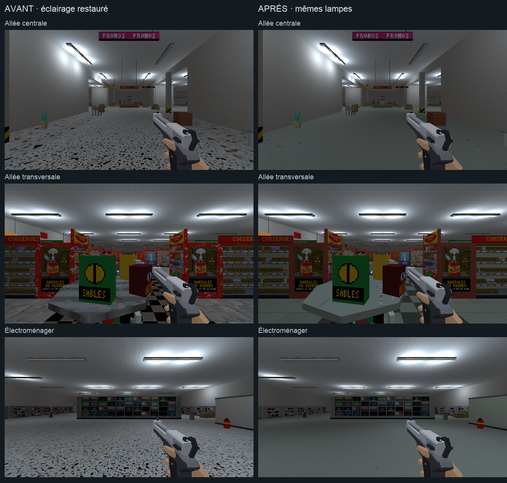

# Direction artistique — surface de vente et mobilier commercial

## Objectif

Poursuivre l’étape 3 [de l’audit](../journal/audit-direction-artistique-2026-10.md)
après [les caisses](caisses-direction-artistique.md), en conservant
l’éclairage d’origine demandé par l’utilisateur. La
[proposition plus sombre](magasin-eclairage.md) est rejetée.

[Ouvrir la revue en jeu](vente-da.html).



[Comparer les équipements](vente-da/details.png).
[Voir le raccord avec les caisses](vente-da/raccord-caisses.png).

## Traitement

- Allée centrale et électroménager : terrazzo à fragments espacés et peu
  contrastés, avec les variantes fine et plus grosse déjà présentes aux caisses.
- Rayons : carrelage à joints fins et damier gris-ivoire plus sobre.
- Gondoles et présentoirs : peinture rouge atténuée, métal clair et tôle
  perforée. Les anciennes taches très contrastées quittent ces structures.
- Appareils et équipements froids : émail clair et métal de la même famille.
- Palettes et cartons : fibres de bois et de papier avec des rampes resserrées.

Les dix familles utilisent des textures de 128×128 pixels pour 2 m,
soit 64 texels/m. Les surfaces du mobilier reçoivent des UV métriques.
Les produits, les étiquettes, les vitrages et les faces d’atlas conservent
leurs coordonnées. Cette passe porte sur les matières de 12 sols et
277 éléments de mobilier, sans déplacement du décor.

## Éclairage restauré

`tools/blender/restore_store_lighting.py` restitue les poses et propriétés
des 245 sources et les matières des 137 luminaires depuis
`renders/_cassandre/niveau_v2_avant_eclairage.blend`.
L’ambiante hybride revient à 0,18 ; les adaptations runtime de la proposition
sont retirées. Le [relevé de restauration](magasin-eclairage/restauration.json)
et le [relevé des lampes avant cette passe de textures](vente-da/lampes-avant.json)
conservent la trace du retour.

## Reproduire les textures

`tools/art_direction/store_sales.py` sélectionne les sols, les pièces de
mobilier à matière unique et leurs familles, avec les recettes de
`tools/art_direction/surface_recipes.py`.
`tools/blender/refresh_store_sales.py` applique la passe au magasin construit,
sauvegarde le `.blend` et exporte le `.glb` contrôlé.
La copie avant textures est conservée dans
`renders/_cassandre/niveau_v2_avant_vente_da.blend`, avec l’éclairage restauré.

```sh
/Applications/Blender.app/Contents/MacOS/Blender \
  -b assets_src/blender/niveau_v2.blend \
  -P tools/blender/cassandre_cli.py -- art_direction_sales
```

La reconstruction normale `tools/level_v2/build_niveau.py` appelle aussi
la recette après celle des caisses. Le build complet n’est pas relancé
pendant cette passe locale.

Sorties : `assets_src/blender/niveau_v2.blend`,
`public/assets/levels/niveau_v2.glb` et
[manifeste des 289 meshes traités](vente-da/deploiement.json).
L’export contient 3 977 objets, sans intrus de bibliothèque.

## Observation

Les [six poses](vente-da/poses.json) montrent l’allée centrale, l’allée
transversale, les gondoles, les surgélés, l’électroménager et les appareils.
Les images avant et après utilisent l’éclairage restauré, le même pistolet
et la résolution 640×360/aniso. Les relevés
[avant](vente-da/poses-avant.json) et [après](vente-da/poses-apres.json)
sont conservés ; les captures montrent le monde sans les overlays.

Un déplacement demandé de 0,5 s avance de y=47 à y=51,45, z=0,01.
La [vue après déplacement](vente-da/en-marche.png) et
[son relevé](vente-da/deplacement.json) complètent les comparaisons.
Les [six vues Blender](vente-da/blender.png), les deux planches et la vue
après déplacement sont ouvertes et relues. Le jeu arbitre la lecture finale.

Aucune suite de tests automatisés n’est lancée. Cette observation ne vaut
pas playtest des combats ni mesure complète de performance.

## Suite

La prochaine passe de matières concerne les autres locaux du magasin,
en commençant par la cafétéria. Les interactions et la signalétique gardent
leurs lots dédiés dans l’audit.
